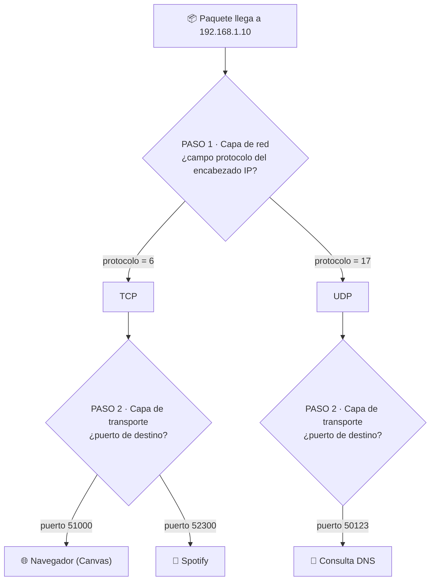
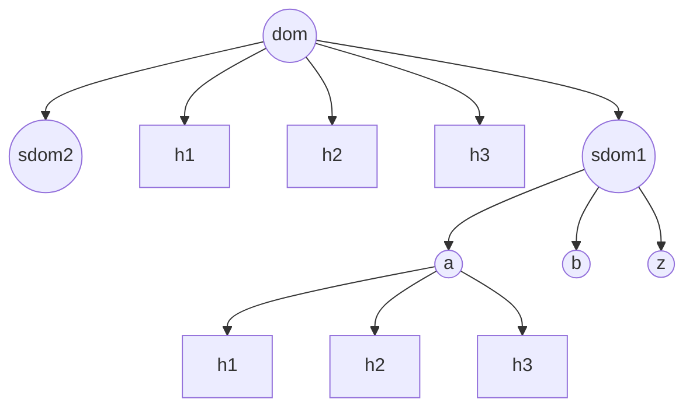

# Resumen P4
### DNS

- La multiplexacion en dos niveles: la capa de red usa un campo de encabezado IP para saber si el segmento va a un protocolo u otro, la capa de transportes usa los puertos para saber a que proceso entregarlo. Se puede decir que el computador solo tiene una direccion IP, que corren varos programas aho dentro, la pregunta es como sabe el sistema operativo a cuel se lo tiene que entregar,\
**Por ejemplo:** tenemos la ip del computador y tenemos abierto canvas que ocupa TCP al igual que spotify y miuandes.cl que ocupa UDP, a la tarjeta de red llegan los 3 a la misma IP

\
como se puede ver hay dos capas la que saca el el campo del protocolo de la ip y el segundo la que saca el puerto que es a donde se va a mandar cada proceso a travez del puerto.

- **El nombre como indireccion:** al final a los humanos es mucho mas facil recordar nombres que su valor como tal entronces con esto se puede cambiar su valor sin necesidad de cambiar el nombre, como lo hacemos con las variables dentro de un prigrama, si los usuarios ocuparan la ip todos tendrian que tener anotadas las iop de cada uno los enlaces guardados ya no servirian dado que los solo se cambia un registro dentro del DNS

- **Hosts.txt:** Es un archivo que yenia una linea por host, con el formato de la ip y el nombre del host, lo que hacia es que tu te conectabas y el administrador le avisaba al NIC, el NIC actualizaba esa dirección en su srevidor, todos descargaban la nueva tabla de direcciones periodicamente, luego se buscaba en una copia local, es como una gui atelefonica. el problema es que no se podia mantener con el tamaño y las incrementaciones constantes do hosts.

- Espacio plano vs Jerarquico: el espcaio **plano** tiene que ser unico para todo el mindo, se usaba el truco de anteponer la institucion, es como la jerarquia del pobre eso.\ El **espacio Jerarquico** el nombre tiene que ser unico dentro de sus hermanos por ejemplo www.uandes.cl y www.uchile.cl ambos tienen www pero bajo diferentes nombres. al final es como las carpetas del computador, home/ana/notas es una ruta valida y home/pedro/notas tienen las misma cosas pero no se conflictuan dado que cada carpeta controla sus nombres, al final cada nodo puede ser administrado por alguien distinto

## TLD (Top Level Domain)
son los que cuelgan directo de la raiz
|tipo|ejemplo| origen|
|---|---|---|
|primero | .arpa|sufijo para los hosts de arpa|
|genericos|`.com` `.org` `.gov` |por tipo de organizacion|
|pais|`.cl``.bl`|codigo iso 3166|

todos los paises reconocidos por la onu tiene su propio TLD automaticamente 
al final lo que se registra bajo .cl por ejemplo es administrado por Chile, no por la entidad que crea los TLD.
> ICANN es la organizacion que adminisgtra los TLD, pero no administra los paises, solo los TLD genericos y el .arpa

entonces un ejemplo seria el de la www.uandes.cl
ICANN/raiz -> delega .cl a -> NIC Chile -> delega uandes.cl a -> Universidad de los andes


### Gramatica BNF (Backus-Naur Form)
Es la forma de escribir reglas que dicen que cadenas son validas por ejemplo www.computing-networking.info.
```bnf
<nombre> ::= <subdominio> "." <dominio> "." <TLD>
<subdominio> ::= <letra> | <subdominio> <letra>
<dominio> ::= <letra> | <dominio> <letra>
<TLD> ::= <letra> | <TLD> <letra>
<letra> ::= "a" | "b" | "c" | ... |
```     

El DNS es una base de datos distribuida de nombres -> direcciones.
usa un modelos de cliente servidor donde los clinetes son los host o aplicaciones que quieren traducir un nombre, los servidores denombres guardan un pedazo ede la base de datos y respionden consultas.

el servidor responsable de dom puede responder directamnete la direccion de cualquier host que este dentro de dom pero dom no sabe lo que pasa en sus nietos en el fondo, la analogia aca es un director de carrera conoce a sus jefes de departamento pero no conoce a los ayudantes, para eso le pregunta a sius jefes de departamento, que son los servidores responsables de sdom1 y sdom2, ellos si conocen a sus ayudantes y pueden responder la consulta. se resume en: \
1. clinete -> servidor de dom: h3.a.sdom1.dom? \
2. servidor de dom -> servidor de sdom1: h3.a.sdom1.dom
3. servidor de sdom1 -> servidor de a: h3.a.sdom1.dom
4. servidor de a -> Es 10.5.5.3

al final no da respuesta pero sabe a quien preguntarle.

los servidores de raiz para bajar por el arbol hay que ir desde arriba y para eso hay que sabel los TLD y empezar a bajar, como el servidor de raiz conoce todos lo TLD asi se puede resolver todos.

Entonces para que quede mas claro, lo directorios raiz es un servidor aparte que tiene los TLD y ahi se puede empezar a abajar por el arbol, para esto se necesita un intermediario que mantenga estos directorios raiz, que generalmente son los proovedores de internet, entonces lo que se hace es que la forma recursiva es que yo pregunto una direccion, luego el servidor pregunta a los sevidores raiz y despues eso entrega a los TLD y asi hasta que te devuelve la IP.

las ventajjas que da son las siguentes los host no necesitan mantener las raices solo saben la ip del resolver, solo se manda una consultra al resolver no a todo el internet el cache compartida

lo bueno es que el primero que hace la consulta mediante el cache se guarda todo el recorrido y al resto le llega al instante.

Lo bueno de nombrar es que ganamos 3 cosas lo primero es uqe se puede mover el servidor y el nombre queda estatico, es cosa de cambiar el valor del nbombre a la nueva direccion ip, lo segundo es que un nombre puede tener asociado varias direcciones y dependiendo de la consulta que se le haga lo va redirigiendo a la que mejor conviene y un servidor puede tener alojadas varias direcciones IP. 

## DNS

El DNS puede funcionar sobre TCP y UDP, pero normalmente se usa UDP para consultas cosas rapidas y TCP para transferencias de zona respuestas largas. El puerto 53 es el puerto estándar para DNS.

### Estructura de un mensaje DNS
tiene 5 campos toda pregunta y respuesta:

- **Header:** tipo de mensaje, flags y cuantos registros hay en cada seccion, es de caracter obligatorio
- **Question:** La pregunta por ejemplo A de www.unades.cl, es obligatorio
- **Answer:** La respuesta a la pregunta, viaja vacia en un principio cuando se hace la pregunta pero al recivir respuesta es obligatorio
- **Authority:**  contiene la informacion de los servidores de nombres autoritativos, es opcional 
- **Additional:**  contiene informacion adicional que puede ser util para el cliente, es opcional

### Header
tiene 12 bytes y contiene la siguiente informacion:
- **ID:** es de 16 bits y es un identificador, es un numero random que elige el cliente al preguntar el servidor lo copia en su respuesta asi se sabe que pregunta va aque respuesta
- **Flags:** 16 bits, contiene banderas que indican el tipo de mensaje
    - **QR:** 1 bit que indica si es pregunta o respuesta, 0 es pregunta y 1 es respuesta
    - **Opcode:**  4 bits tipo de operacion, consulta estandar o actualizacion
    - **AA:** 1 bit Authoritative answer, 1 si el uqe responde es autoritativo para ese nombre
    - **RD:** 1 bit de Recursion desired, el cliente lo pone en 1 si quiere que el servidor haga la recursion, en caso contrario el servidor solo le dice a quien preguntarle que es iterativa.
    - **RA:** 1 bit Recursion available, es el servidor si puede hacer la recursion.
    - **RCODE:** 4 bits, distingue tipode de error, por ejemplo NOERROR es exito o NXDOMAIN que es que el nombre no existe


AA cuando es uno significa que el dueñp del dominio por ejemplo uandes.cl es el que responde queda en uno, cuando no va en cero, generalmete cuando llega a nuestro computador el AA es cero, solo se pone en uno cuando sale de la fuente de verdad.

Al final del header hay 4 contenedores que indican cuantos registros hay en cada seccion de question aswer, authority y additional.

### Registros de recursos 

de estos 4 todos tienen el mismo formato:
- **NAME:** a que nombre se refiere por ejemplo www.uandes.cl
- **TYPE:** que tipo de dato es A, AAAA, entre otros,
- **CLASS:** que clase es, casi siempre es IN de internet
- **TTL:** cuantos segundos puede guardar en cache el registro
- **RDLength:** largo del campo de data 
- **RDATA:** el datop en si cuyo formato depende del tipo, ejemplo 104.x.x.x

El TTL lo fija el servidor que responde indica cuanto tiempo un resolver o clinete guarda registtro en el cache antes de volver a preguntar si es largo es estable menos cinsultras pero los cambios tardan en propagarse si es corto es para servidores posplares o moviles


### Tipos de registros
- **A:** direccion IPv4 ejemplo 104.x.x.x
- **AAAA:** direccion IPv6 ejemplo 2001:db8::1
- **NS:** que servidor es responsable de un dominio dean.ns.claudflare.com
- **CNAME:** alias, este nombre es otro nombre, por ejemplo www.uandes.cl es un alias de uandes.cl
- **MX:** servidor de correos
- **PTR:** registro de tipo pointer, usado para reversa de direcciones IP

El DNS es extendible gracias a los campos TYPE y RDLeangth, se pueden inventar tipos de registros sin cambiar el protocolo, por ejemplo si un programa recibe un tipp que no conoce s¿puede saltarselo pirque sabe cuiantos bytes ignoraer

### MX
Lo que hace es que asocia un dominio con un servidor de correo, elige el numero mas bajo dentro de las prioridades y despues devuelve la direccion IP de ese servidor 

## Resumen apuntes
zona = la parte del arbol que administra una misma entidad con los mismos servidores autoritativos, ejemplo la zona cl es NIC Chile y la zona uandes.cl es de la universidad via cloudflare.\
La zona padre no guarda los registros de sus hijos solo guarda la delegacion de a donde van con respecto a la quer, los nombres van en registros NS

### registros principales 
- SOA: start of authority: la ficha tecnica de la zona, una zona tiene un servidor primario donde el administrador edita los registros y uno o mas secundarios que copian la zona del primario para tener respaldo, el SOA dice como se coordinan
```sh
@ IN SOA ns1.example.com. admin.example.com. (
    2026110201 ; serial
    7200       ; refresh
    900        ; retry
    1209600    ; expire
    300 )      ; minimum (TTL negativo)

```
entonces aca que es lo que dice, el servidor primario es ns1.example.com., el correo del administrador es admin.example.com. que el primer punto de reemplaza con un @, el serial que es 2026110201 es el numero de version de la zona, refresh 7200 que son dos horas el secundario pregunta si cambio de serial, retry 900 que son 15 minutos si el primario no contesta reintenta, expire 1209600 son 14 dias sin hablar con el primario el secundario deja de resonder y el minimum 300 5 min cuanto se huarda en el cache una respuesta negativa, ese nombre no existe por ejemplo. el serial es clave: el secundario solo copia si el serial aumento. si cambias un registro y olvidas aumentar el serial los secundarios nunca se enteran y siguen entregando los datos viejos.

Ejemplo: si hacemos el de uandes.cl el SOA es
```sh
dean.ns.cloudflare.com. dns.cloudflare.com. 2419051871 10000 2400 604800 1800
```
al final lo que podemos decir es que es
- primario: dean.ns.cloudflare.com.
- responsable (correo): dns.cloudflare.com. (dns@cloudflare.com)
- 2419051871: serial
- 10000: refresh (2h 46m 40s)
- 2400: retry (40m)
- 604800: expire (7d)
- 1800: minimum (30m)

## NS (name server):
```sh
 @ IN NS ns1.example.com.
 @ IN NS ns2.proveedor.net.
```
los servidores autoritativos de la zona, el @ es un comodin que significa el nombre de la zona, en este caso example.com. y proveedor.net. son los servidores autoritativos de la zona.
generalmente se usan 2 por si una cae el otro pueda seguir respondiendo, los NS aparecen en dos partes dentro de la propia zona y la del padre

> NOTAS: los servidores que tienen la informacion oficial de example.com. el NS describe la zona entera, al final es quien atiende a este dominio, es un nombre no una IP


A y AAAA: son los registros de direccion, basicamente va de nombre a IP
```sh
@  IN A 192.0.2.20  -> example. com tiene IPv4
@  IN AAAA 2001:db8::20  -> example.com tiene IPv6
```

CNAME: es un alias, por ejemplo www.example.com es un alias de example.com, entonces cuando alguien pregunta por www.example.com el servidor autoritativo responde que es un CNAME de example.com y el cliente vuelve a preguntar por example.com y ahi si le responde con la IP.


### DUDAS
cuando un archivo de zona parte con un `$ORIGIN example.com.` significa que despues se puede abreviar con un @

la diferecia en www con el @ es que el www es un subdominio de example.com y el @ es un comodin que significa el nombre de la zona, en @ generalmente va SOA, NS MX, TXT y a veces va a A, en cambio en el que le anteponemos www que es el subdominio va el A, AAAA, CNAME


### Delegacion y glue 

cuando registras un dominio en el NIC Chile le dices mis servicios autoritativos son tales entonces el NIC Chile publica esos NS en la zona cl, eso es delegacion. al final lo que hace el NIC es que solo anota quien esta acargo y despues el encargado se encarga de mantener

**Que pasa cuando registras una pagina nueva?**

primero hay que decir cuales son sus servidores autoritativos, por ejemplo su tomamos miproyecto.cl
```sh
ns1.proveedor.net
ns2.proveedor.net
```

lo que hace el NIC Chile es agrega las siguentes lineas a su zona cl
```sh
miproyecto.cl. IN NS ns1.proveedor.net.
miproyecto.cl. IN NS ns2.proveedor.net.
```
esas dos lineas son la delegación, que basicamente dice que miproyecto.cl lo atiende los servidores ns1.proveedor.net y ns2.proveedor.net, entonces lo que haces es que la zona cl sabe cuales son los servidores de miproyecto.cl pero no sabe nada de miproyecto en si solo sabe a quien preguntarle. 

**como conseguir la IP del servidor sin glue**
el caso de la uandes que lo atiende el servidor de claudflare, lo que hace es lo siguiente:
1. raiz -> com lo atiende ...
2. servidor de com -> claudflare.com lo atiende ...
3. claudflare.com -> dean.ns.cloudflare.com es 173.245.x.x


El problema esta cunando por ejemplo un mismo ns tiene el dominio y el nombre igual
```sh
miproyecto.cl. IN NS ns1.miproyecto.cl.
```
entonces para saber la IP de ns1.miproyecto.cl el servidor de cl no sabe a quien preguntarle porque no tiene la IP de ns1.miproyecto.cl.

para eso NIC lo que hace es que publica las IP de los servidores autoritativos en la zona cl, eso es el glue, entonces el NIC Chile publica las siguientes lineas en su zona cl
```sh
uchile.cl NS ns1.uchile.cl.
uchile.cl NS ns2.uchile.cl.
ns1.uchile.cl A 200.89.70.3
ns2.uchile.cl A 200.89.70.70
```

esos ultimos dos son el glue, basicamente se publiuca la IP de los servidores autoritativos de uchile para que no exista el problema de que no sabe a quien preguntarle.


### REPASO HASTA AHORA 

autoritarivo es una propiedad de un servidor dentro de un arbol, un servidor es autoritativo cuando es para su propia zona, los raices son autoritativos para la zona raiz.

las zonas de mayor a menor son:
1. ZONA RAIZ: son los servidores que tienen los TLD como .com, .cl entre otros.

2. ZONA TLD: son los servidores que son administrados generalmente por la NIC de cada pais, NIC chile administra la zona .cl

3. ZONA DELEGADA: son los servidores que son adminsteados por el dueño del dominio, por ejemplo la zona uandes.cl es administrada por la universidad de los andes via claudflare.


### TTL 
el cache es simple, al final lo que hace es que guarda el resultado de la query y lo manda directo al segundo que pregunta 

cuando el ttl es muy alto el servidor tiene porca carga la velocidad es rapido pero al final se pueden quedar con una version antigua si se cambia mucho.

bajar la ttl antes del cambio, lo que se hace es que se baja con anticipacion si se sube el serial, luego luego cuando se actualiza se cambi la ipy despues vuelves a subir la TTL cuando pones la TTL en cadena con un CNAME igual manda la TTL de A dado que CNAME depende de esa IP 

### DIG 
los comandos de DIG son los siguientes:
- `dig example.com SOA` -> pide el SOA al resolver
- `dig example.com NS` -> pide los autoritativos al resolver
- `dig example.com MX +short` -> pide los MX, solo datos al resolver
- `dig www.example.com A` -> pide la IP al resolver
- `dig www.example.com +trace` -> todo el recorrido desde la raiz, es raiz -> TLD -> autoritativo -> IP 
- `dig example.com NS @a.nic.cl +norecurse` -> pregunta a un servidor autoritativo de cl, no al resolver, para ver que NS tiene la zona cl


## Transporte sockets UDP y TCP

### Multiplexacion y demultiplexacion

- Multiplexacion:  es cundo se juntan varios procesos dentro de una sola IP

- Demultiplexacion: es cuando se reciben los datos y se separan para que cada correspondiente le llegue a cada segmento.

se hace en dos pasos, la capa red mira el campo protocolo del encabezado IP y reviosa si es TCP o UDP, la capa mira los puertos y ellige el socket

los dos tipos de puertos son:
- **Puertos bien conocidos:** los ocupa el servidor que los elige con un bind para que los clientes por convencion sepan donde encontrarlos por ejemplo HTTP es el 80

- **Puertos efimeros:** Los ocupa el cliente y el sistema operativo asigna uno aleatorio para que el servidor le pueda responder, por ejemplo cuando tu computador hace una consulta DNS el sistema operativo le asigna un puerto efimero para que el servidor le pueda responder.

### Como se identifica cada socket 

El socket es el punto de acceso que el sistema operativo le a a un proceso para enviar y recibir datos por la red, cada socket queda asociado a una IP y un puerto local. 

Analogía: si la IP es el edificio y el puerto es el número de departamento, el socket es el buzón de ese departamento. Cuando llega algo, el sistema operativo tiene que decidir en qué buzón dejarlo.

El problema esta en como se sabe a quien mandarle y como se recive

### UDP solo se mira el destino y la IP
En UDP, el servidor abre un solo socket y lo asocia con bind a un puerto conocido, por ejemplo el 50001. Usa "" (o 0.0.0.0) para escuchar en todas sus interfaces. No hay conexión previa: cualquier programa que conozca la IP y el puerto del servidor puede enviarle un datagrama. Por ejemplo, tres clientes distintos le escriben: el cliente A desde 1.1.1.1:60777, el cliente B desde 2.2.2.2:51234 y el cliente C desde 1.1.1.1:60778. Cada puerto efímero lo asignó el sistema operativo de cada cliente al llamar a sendto; por eso A y C, aunque están en el mismo computador, tienen puertos distintos. Cuando llegan los tres datagramas, el sistema operativo del servidor mira solo el destino (su IP y el puerto 50001) y los deja todos en el mismo socket. El programa los lee uno a uno con recvfrom, que le entrega los datos y la dirección de origen de cada uno. Con esa dirección responde con sendto, invirtiendo origen y destino: la respuesta para A va a 1.1.1.1:60777, la de B a 2.2.2.2:51234 y la de C a 1.1.1.1:60778.

```sh
Cliente A  1.1.1.1:60777  ─┐
Cliente B  2.2.2.2:51234  ─┼──►  servidor :50001  →  UN SOLO socket
Cliente C  1.1.1.1:60778  ─┘     recvfrom le dice de quién es cada uno
```

### Conexion via TCP
Sockets TCP. El servidor crea primero un socket de escucha (bind + listen), asociado a su IP local y al puerto conocido del servicio, por ejemplo el 443 para la web. Ese socket solo recibe solicitudes de conexión: nunca transporta datos. Cuando un cliente llama a connect, los sistemas operativos hacen el handshake de tres vías, y después accept() le entrega al servidor un socket nuevo por cada conexión. Cada socket conectado queda identificado por su cuádrupla: IP y puerto del cliente (el puerto es efímero) + IP y puerto del servidor. Recién con la conexión establecida se pueden transferir datos, y como el socket ya está conectado con un solo cliente, se envía y recibe con sendall y recv sin indicar la dirección. Cuando el otro extremo cierra la conexión, recv retorna b"". Con n clientes conectados, el servidor tiene n + 1 sockets: el de escucha y uno por conexión.
```sh
                       ┌─────────────────────────┐
Cliente A ─┐           │ socket de ESCUCHA :50002│
Cliente B ─┼─connect─► └───────────┬─────────────┘
Cliente C ─┘                       │ accept() ×3
                  ┌────────────────┼────────────────┐
                  ▼                ▼                ▼
          (1.1.1.1:60777,   (2.2.2.2:51234,   (1.1.1.1:60778,
           srv:50002)        srv:50002)        srv:50002)
           socket A          socket B          socket C
```

### Diferencias 
1. **conexion:** UDP no tiene conexion mientras que TCP tiene que establecer la conexion con un handshake antes de enviar los datos. 

2. **confiabilidad:** UDP no tiene confiabilidad dado que los datos pueden perderse en la mitad no se sabe si llego o no, no hay conexion, se puede quedar en la mitad mientras que TCP se asegura que llega y directamente dado que hay conexion y se hace un seguimiento de los datos enviados y recibidos, si no llega se reenvia.

3. **Unidad de datos:** cada datagrama se conservan los limites de los mensajes mientras que TCP es un flujo de bytes por ende hay que delimital los mensajes, la analogia es que UDP es como mandar cartas separadas, TCP es como una manguera de agua que no sabes donde empieza y termina cada gota de agua. llega en orden y todo pero no sabemos los limites de los mensajes.

4. **control de flujo y congestion:** no hay, el mensaje llega tan rapido como puede mientdas que TCP tiene control de flujo que el receptor dice cunato puede recibir y el control de congestion como se hacen conexiones puede frenar cuando se satura

5. **Destnatarios:** UDP puede mandar a varios destinatarios si quiere pero TCP es una conexion de punta a punta con uno.  


## Parada y espera 
es la forma mas segura de mandar datos, lo que hace es que manda el dato, espera la confirmacio de que llego para mandar el siguente, se usa un temnporizador, si no llega la confirmacuion en ese tieempo se asume que se perdio algo 

### el pipelining y la ventana deslizante
el pipelining es mandar varios datos sin esperar la confirmacion, el problema es que si se pierde un dato hay que volver a mandar todos los datos que se enviaron despues de ese,
la ventana deslizante es que se puede mandar varios datos sin esperar la confirmacion pero si se pierde un dato solo se reenvia ese dato y los que se enviaron despues de ese.
```sh
PARADA Y ESPERA                    PIPELINING (ventana de 3)

Emisor        Receptor             Emisor        Receptor
  │─ dato 0 ──►│                     │─ dato 0 ──►│
  │            │                     │─ dato 1 ──►│
  │◄── ACK 0 ──│                     │─ dato 2 ──►│
  │─ dato 1 ──►│                     │◄── ACK 0 ──│
  │            │                     │─ dato 3 ──►│   ← apenas llega un ACK,
  │◄── ACK 1 ──│                     │◄── ACK 1 ──│      sale otro dato
  │─ dato 2 ──►│                     │─ dato 4 ──►│
```

la ventana deslizante es que se puede mandar varios datos sin esperar la confirmacion pero si se pierde un dato solo se reenvia ese dato y los que se enviaron despues de ese. y solo manda cuando llega la congfirmacion del el primero que llega al final es como un mesero qeu puede llevar maximo n cantidad de platos, si se satura y no le llega confirmacion de que el cliente le llego el plato no puede ir a biucar otro.
```sh
Inicio:          [ 0  1  2 ] 3  4  5     → puede enviar 0, 1 y 2
Envía 0, 1, 2:   [ 0  1  2 ] 3  4  5     → ventana CERRADA: debe esperar
Llega ACK 0:       0 [ 1  2  3 ] 4  5    → se desliza: ahora puede enviar el 3
Llega ACK 1:       0  1 [ 2  3  4 ] 5    → se desliza: ahora puede enviar el 4
```

cuando un dato se pierde hay estrategias que dicen que hacer en cada caso el go back and repeat que manda un ack por dato si uno se pierde retrocede n veces hasta el ato que se perdio y vuelve a mandar todos, selective repear es que guarda los datos en un buffer si se pierde uno y solo vuelve a mandar el que se perdio y los que se enviaron despues de ese, el problema es que hay que tener un buffer para guardar los datos que llegaron despues del perdido.

```sh
go back and repeat (ventana de 3)
Emisor                          Receptor
  │─ dato 0 ──────────────────►│  ✅ en orden → ACK 0
  │─ dato 1 ────── ✗ (perdido)
  │─ dato 2 ──────────────────►│  ❌ esperaba el 1 → DESCARTA, reenvía ACK 0
  │─ dato 3 ──────────────────►│  ❌ esperaba el 1 → DESCARTA, reenvía ACK 0
  │   ⏱ expira el timer
  │─ dato 1 ──────────────────►│  ✅ (retransmite TODO desde el 1)
  │─ dato 2 ──────────────────►│  ✅
  │─ dato 3 ──────────────────►│  ✅
```


```sh 
selective repeat (ventana de 3)
Emisor                          Receptor
  │─ dato 0 ──────────────────►│  ✅ entrega el 0
  │─ dato 1 ────── ✗ (perdido)
  │─ dato 2 ──────────────────►│  📦 lo GUARDA en el buffer
  │─ dato 3 ──────────────────►│  📦 lo GUARDA en el buffer
  │   ⏱ expira el timer del 1
  │─ dato 1 ──────────────────►│  ✅ ahora entrega 1, 2 y 3 juntos, en orden
```

### Tasa de transmision
puede enviar W datos por cada RTT, 

```sh
Tasa = W / RTT
```
```sh
tasa maxima = (W x MSS) / RTT
```

|Termino|Que es|Unidad tipica|
|---|---|---|
|W|Tamaño de la ventana|segmentos|
|MSS|Maximum Segment Size|bytes|
|RTT|Round Trip Time|milisegundos|


- Preguntas:
1. W = 10 segmentos, MSS = 1460 bytes, RTT = 100 ms.

1460*10 = 14600 bytes
14600 / 100 = 146 bytes/ms
146 * 1000 = 146000 bytes/s = 146 KB/s
tasa en bits = 146000 * 8 = 1168000 bits/s = 1.168 Mbps

2. Ejemplo 2 · El del libro: la ventana de 64 KB

En TCP original, la ventana máxima era de 65.535 bytes, porque su campo en el encabezado tiene 16 bits. Con RTT = 10 ms:

65535*8 = 524280 bits
524280 / 0.01 = 52428000 bits/s = 52.428 Mbps

### Tipos de ventana

| Ventana | Quién la define | Qué limita | Para qué existe |
|---|---|---|---|
| **W** (ventana deslizante) | El protocolo | Cuántos mensajes se pueden tener enviados y sin confirmar | Hacer pipelining sin saturar |
| **swin** (ventana de envío) | El emisor, según su memoria | Cuántos datos puede guardar en su buffer de envío | No quedarse sin memoria |
| **rwin** (ventana de recepción) | El receptor, que la anuncia en cada ACK | Cuánto espacio libre tiene el receptor | **Control de flujo**: no saturar al receptor |
| **cwnd** (ventana de congestión) | El emisor, según las pérdidas que detecta | Cuánto deja enviar el estado de la red | **Control de congestión**: no saturar la red |
| **Ventana efectiva** | Se calcula | Lo que realmente se puede enviar | Respetar los tres límites a la vez |

**Fórmulas:**
- Ventana efectiva = mín(cwnd, rwin, swin) → **siempre manda la más chica**
- Tasa ≈ Ventana efectiva ÷ RTT

**Ejemplos:**
- cwnd = 20, rwin = 8, swin = 50 → ventana efectiva = **8** (manda el receptor)
- cwnd = 4, rwin = 30, swin = 50 → ventana efectiva = **4** (manda la red)

> **ssthresh no es una ventana:** es el umbral de cwnd. Bajo él, slow start (crece exponencial); sobre él, congestion avoidance (crece lineal).


- Slow start: es la fase inicial de TCP como no sabe como es el estado de la red lo que hace es que parte con un cwin de uno y lo va duplicando por cada ACK hasta que llega al umbral de ssthresh, ahi pasa a congestion avoidance que es que va aumentando de uno en uno por cada RTT, si se pierde un paquete se asume que hay congestión y se reduce el cwnd a 1 y el ssthresh a la mitad del cwnd que tenia antes de perder el paquete.


### Tres ACK duplicados y expiracion del temporizador
- Tres ACK duplicados: cuando el emisor recibe tres ACK duplicados, significa que un segmento se perdió, pero los siguientes llegaron. Entonces el emisor hace fast retransmit: retransmite el segmento perdido y reduce cwnd a la mitad (ssthresh = cwnd/2)

```sh 
Emisor                          Receptor
  │─ seg 3 ──────────────────►│  → ACK 3
  │─ seg 4 ────── ✗ (perdido)
  │─ seg 5 ──────────────────►│  → ACK 3   ← duplicado 1 ("sigo esperando el 4")
  │─ seg 6 ──────────────────►│  → ACK 3   ← duplicado 2
  │─ seg 7 ──────────────────►│  → ACK 3   ← duplicado 3  ⚠
  │                            
  │─ seg 4 ──────────────────►│  (retransmisión rápida, sin esperar el timer)
```

- expiración del temporizador: si el emisor no recibe ACK antes de que expire el temporizador, asume que hay congestión y reduce cwnd a 1 (ssthresh = cwnd/2). Esto es más drástico que los tres ACK duplicados, porque no sabe si se perdió un segmento o varios.
```sh
ssthresh = cwnd / 2
cwnd     = 1 MSS             ← vuelve al INICIO
→ vuelve a SLOW START}
```

### CIDR
una direccion IPv4 son 32 bits, se escriben 4 numeros del 0 al 255 separados por puntos.
la direccion se divide en dos partes la de red y la de host, la primera parte es el prefijo de la red y la segunda es la del host como tal, el numero despues de la barra indica cuantos bits son de la red. la mascara es lo mismo los 1 equivalen a red y los 0 a host.

asi se hace la conversiond e la mascara
| Bits en uno | Octeto en binario | Suma de pesos | Decimal |
|---|---|---|---|
| 0 | `00000000` | — | **0** |
| 1 | `10000000` | 128 | **128** |
| 2 | `11000000` | 128 + 64 | **192** |
| 3 | `11100000` | 128 + 64 + 32 | **224** |
| 4 | `11110000` | 128 + 64 + 32 + 16 | **240** |
| 5 | `11111000` | 128 + 64 + 32 + 16 + 8 | **248** |
| 6 | `11111100` | 128 + 64 + 32 + 16 + 8 + 4 | **252** |
| 7 | `11111110` | 128 + 64 + 32 + 16 + 8 + 4 + 2 | **254** |
| 8 | `11111111` | 128 + 64 + 32 + 16 + 8 + 4 + 2 + 1 | **255** |

dentre de hay tres tipos de direcciones:
- Red: que es la primera direccion que esta reservada.
- Broadcast: que es la ultima direccion que esta reservada.
- Host: que son todas las direcciones que estan entre la red y el broadcast, son las que se pueden asignar a los host.


el atajo es el siguente para saber cual es cual, primeo es hacer una lista que sume de 2^n bits de host, del 0 al 255, luego se calcula en que grupo cae los ultimos de la ip y se revisa y la red es el primero del grupo el broadcast es el ultimo del grupo y los host son todos los que estan entre medio.

cuando queda en el 3 de 4 solo se trabaja en el 3 de los 4 numeros y el de red queda en 0 el 4 y el de broadcast queda en 255 el 4 y los host son todos los que estan entre medio.

cuando se quieren hacer subredes las formulas son las siguentes 
cuantas subredes salen
```sh
2`(q-p) >= numero de subredes deseadas
siendo p el bloque de bits de red y q las subredes que se quieren hacer 
```
cuantos hosts tiene cada una 
```sh
2^(32-q) - 2 >= numero de hosts deseados
```

```sh
Paso 1 · Repartir el prefijo:     21 = 8 + 8 + ?     → octeto partido: el ?
Paso 2 · Máscara:                 255.255.?.0         (busca ? unos en la tabla)
Paso 3 · Tamaño del grupo:        2^(bits de host en ese octeto) = ?
Paso 4 · ¿En qué grupo cae 75?    múltiplos del tamaño: 0, ?, ?, ... → inicio ?, fin ?
Paso 5 · Red:                     172.18.(inicio).0
         Broadcast:               172.18.(fin).255
Paso 6 · Hosts:                   2^(32 − 21) − 2 = ?
```
### Guía para resolver una dirección con prefijo

Ejemplo: **172.18.75.40/21**

**Paso 1 · Repartir el prefijo de a 8.**
Ver cuántos octetos quedan enteros de red y en cuál cae el corte (el **octeto partido**), con cuántos bits de red y de host tiene.
> 21 = 8 + 8 + **5** → el 3.er octeto tiene 5 de red y **3 de host**. El 4.º es todo de host.

**Paso 2 · Máscara.**
Los octetos enteros de red son 255. En el partido, **sumar los pesos de los bits de red**: 128 + 64 + 32 + … El resto, 0.
> 5 bits → 128 + 64 + 32 + 16 + 8 = **248** → máscara **255.255.248.0**

**Paso 3 · Tamaño del grupo.**
**2^(bits de host del octeto partido)**. Solo los bits de host **de ese octeto**, no todos.
> 2³ = **8** (también: 256 − 248 = 8)

**Paso 4 · Dirección de red.**
Tomar el **valor del octeto partido**, **dividirlo por el tamaño del grupo**, quedarse con la **parte entera** y **multiplicarla** por el tamaño. Los octetos **de la derecha** van en **0**.
> 75 ÷ 8 = 9,… → 9 × 8 = **72** → red **172.18.72.0**

**Paso 5 · Broadcast.**
**Red + tamaño − 1** en el octeto partido. Los octetos **de la derecha** van en **255**.
> 72 + 8 − 1 = **79** → broadcast **172.18.79.255**

**Paso 6 · Hosts.**
**2^(32 − prefijo) − 2.** Aquí se cuentan **todos** los bits de host de la dirección.
> 2^(32 − 21) − 2 = 2¹¹ − 2 = **2046**
> Rango asignable: **172.18.72.1** a **172.18.79.254**

**Paso 7 · ¿Pertenece? ¿Se asigna?**

| La dirección… | ¿Pertenece? | ¿Se asigna? |
|---|---|---|
| Es la red | ✅ | ❌ |
| Es el broadcast | ✅ | ❌ |
| Está entre red y broadcast | ✅ | ✅ |
| Está fuera | ❌ | ❌ |

> 172.18.79.255 → pertenece, pero es el broadcast → no se asigna

---

**Ojo:**
- **Paso 3** usa los bits de host **solo del octeto partido** → tamaño del grupo.
- **Paso 6** usa los bits de host **de toda la dirección** → cantidad de hosts.
- En el paso 4 se divide **el valor del octeto** (75) por **el tamaño del grupo** (8), no por la cantidad de bits.
- No olvidar el **−2** en los hosts.


el router esta conectado a varias redes, pero cada una tiene que decidir a donde la manda, eso se hace con una tabla de reenvio que es por donde sale cada paquete

```sh
Destino               Salida
─────────────────     ──────
red de la U       →   eth1
red de casa       →   eth2
todo lo demás     →   eth0
```

y el que escribe la tabla es el ertutamiento que busca el mejor camino para llegar a la red de destino, el router tiene que tener una tabla de reenvio para saber por donde mandar cada paquete, si no sabe a donde mandarlo lo manda a un router vecino que si sepa.