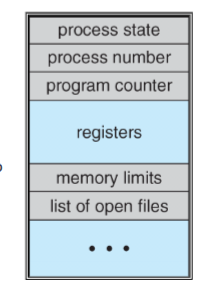
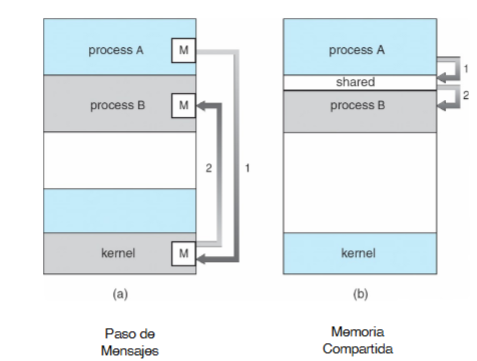

# Clase 1 

estructura de vonnoimann, ver la entrada y salidas y ver los componentes, cpu, memoria y mas o menos como funciona 

# Clase 2

## Que es un proceso?

Un proceso es un programa en ejecucion, el programa esta en la memoria, la cpu ejecuta las instrucciones y los datos tambien deberian estar en la memoria, la imagen es el objeto ejecutable despues de la compilacion guatdada en el disco, para que el proceso pueda ejecutarse debe estar guardado en la memoria primero para poder ejecutarse. Cuando el programa esta en ejecucion tiene un layout.

- texto: codigo de programa
- datos: variables globales
- stack: datos temporales
- heap: memoria asignada dinamicamente

Lo que pasa la cpu cuando de ejecuta un proceso es:
- fetch de la instruccion
- decodificacion
- ejecucion
- escritura de resultados en los registros 
- siguente instruccion y repetir

cuando un proceso esta cargado en memoria tiene un espacio de direcciones para el proceso, el tamaño del espacio depende el tamaño del bus de direcciones, osea de la arquitectura de la CPU, cuando el programa escribe en memoria queda actualizada la direccion de memoria en, puede ser operaciones de I/O. constantemente estamos creando datos en el stack y pedimos datos al heap.

### Estados de un proceso
- new: el proceso se esta creando 
- ready: el proceso esta esperando la cpu
- running: las instrucciones estan siendo ejecutadas por la CPU
- waiting: el proceso esta esperando qeu un evento ocurra, por ejemplo un I/O que se termine
- terminated: el proceso termino 

para un procesador un solo proceso puede estar ejecutandose a la vez, varios procesos pueden estar en estado ready o en waiting

### Process control block (PCB)

cada proceso esta representado en el sistema por un PCB, es el ente que permite mantener el estado de ejecucion del proceso, contiene varios datos que describen el estado de un proceso:
- process  state: new, ready, waiting ...
- program counter: indica la direccion de la siguente instruccion
- registers: dependen de la arquitectura de la CPU
- informacion de planificacion y administracion de la memoria, prioridad del proceso e informacionde la tabla de paginas 
- estado de I/O: lista de dispositivos de I/O asignados al proceso.

### Como se puede hacer que varios procesos funcionen con una sola CPU

#### Multiplexacion de CPU
Con multiprogramacion el SO mantiene varios orocesos ejecutandose en memoria, esto quiere decir que varios procesos pueden estar en estado ready esperando a estar running, solo un proceso puede estar en running por cpu, el quantum de tiempo puede ser super corto a la percepcion del usuario humano, mayor quantum a mayor prioridad, basicamente la rotacion rapida de la CPU causa la ilusion de simultaneadad.

#### Cambio de CPU entre procesos
se conoce como cambio de contexto, los PCB guardan el estado del los procesos de la informacon en los cambios de contextos, los cambios de contextos se pueden gatillar como resultado de una interrupcion por ejemplo un timer. 

## Planificaciond de un proceso 

la idea es mantener la cpu de forma ocupada de la manera mas eficiente, un planificador de procesos se encarga de elegir alguno de los procesos disponibles para que la cpu lo ejecute, la justicia de procesos es alfinal la probailidad que los procesos se ejecuten, estos procesos entran a una cola la cual contiene todos los procesos que se van a ejecutar. los procesos que residen en la memoroa principal y que estan listos entan en una cola y un queue de listo, cuando un proceso espera un I/O enytra a una cola de dispositivos, cuando sale de la cola de se dice que esta dispatch

implementacion de las colas:

la imagen muestra un tipo de colas anclando pcb's

cuando un proceso es despachado podria requerir un I/O o puede esperar un subproceso y espera la la terminacion de este por ende el proceso padre queda encolado esperando que termine, cuando termina un proceso salen de la rotacion de colas, siempre al final terminan volviendo a la cola de los listos hasta que realmente termine el proceso, cuando esta waiting o algo siempe queda encolado en algun lado

los pcb se mueven de cola en cola conforme cambian los estados del proceso 

un proceso migra entre colas en su ciclo que dependen del sistema operativo y los criterios de que proceso elige para ejecutar, hay un planificador especifico para eso 

- planificador de corto plazo (dispatcher)
- planificador de medio plazo
- planificador de largo plazo (job shceduler)

largo y corto plazo difieren en la frecuencia con la que se ejecutan, corto con mucha frecuencia y el largo con poca.

El planificador de largo plazo control a el grado de multiprogramacion en el sistema.

comportamiento de procesos, acotado por cpu el mayor tiempo es en operaciones de computo y por I/O el mayor tiempo es utilizado en operaciones I/O, si es I/O el dispatcher esta casi vacio el otro caso la cola de dispositivos permanece casi vacia.

mediano plazo: sacar procesos de la memoria para reducir la multiprogramacion

### operaciones e procesos 
#### Creacion de procesos 
un proceso puede crear nuevos procesos mediante una system call durante la ejecucion, el creador se llama padre y crea un hijo, el hijo tambien puede crear nuevos hijos y asi se crea un arbol genealogico de procesos, cada proceso tiene un id 

construir un proceso cuesta, el pcb cuesta poco recurso, copiar datos del proceso padre al hijo se llama fork() y copia exactamente el I/O y los datos y esto es costoso, fork es crear un hijo en semejanza, retorna al hijo y al padre devuelven cosas distintas osea al proceso hijo retorna un int que es el indice del proceso.

## Terminacion de un proceso 

cuando un proceso termina se le puede solicitar al SO que elimine sis doatos para liberar recursos, se usa exit()
el wait() es qeu el proceso padre espera a que el hijo termine

los threads son procesos livianos, un hilo puede crear procesos liviando, se requiere una funcion de donde partir esto, no comparten espacios de memoria, necesitan stacks distintos, lo que si sirve es que tiene paralelismo entre procesos, osea los threads pueden ejecutar procesos, se comparten datos en el heap, una lista ligada por ejemplo, por ejemplo en lectura no hay mucho problema pero en escritura si hay, ahi se va a ver 

En resumen un procesos es una abrstacciond del sistema operativo utilizada para representar todo lo que se requiere para ejecutar un programa, un programa puede tener varios o solo un hilo.

no se puede tener infinitos stacks por ende no se puede tener infinitos threads, es limitante por la memoria, un ejemplo un cliente crea una peticion y esto se crea un nuevo thread y ese thread procesa la peticion

las ventajas son:
- mejor respuesta del sistema al usuario
- facilidad de recursos compartidos
- escalabilidad: se puede aprovechar multiprocesadores

hay threads en espacio de usuario y de kernel, habia que restringir la cantidad de threads que habian, los user son threads son administrados por bibliotecas y los kernel, los user threads tienen relaciones con los user, uno a uno, uno a muchos mucho a muchos 

- muchos a uno: muchos user a uno kernel un thread accede a la vez al kernel
- uno a uno: mejor concurrencia que muchos a uno, permite paralelismo mayor costo
- mucho a mucho: se puede hacer paralelismo y ejecutar y ver que thread toma que cosa

# Clase 3
Revision de codigo de los Threads

### Create
al thread se le pasa un puntero a una funcion para que retorne y que para esa funcion tambien reciba los argumentos es una funcion void

### Join
recupera el output de un thread hijo por ejemplo, es el simil a un wait de un thread, hay concurrencia en el ejemplo de t0.c, pero basicamente lo que hacemos es crear dos threads que le pasamos una funcion main y la ejecutan.

cuando dos threads cambian una variable global puede tener un error, eso depende del sheduler y las interrupciones, si se dejan tranquilas no deberia pasar nada.

### Algoritmos de planificacion

permite el uso justo de recursos y que todos los procesos ejecuten. hay procesos que requieren mucho computo y otros que no tanto, los computadores especificamente la CPU tiene rafagas hasta que se interrumpe por una I/O.

un planificador toma una decison cuando pasa de:
- runnin a waiting (cooperativo)
- running a ready
- waiting a ready
- terminacion (cooperativo)

cuando esta el 1 y el 4 el planificador es cooperativo cuando es el segundo caso se dice que es expropiativa. En la planificacion no expropiativa una ve que la CPU toma un proceso, se mantiene hasta que la sea liberada por terminacion o por que cambia a waiting. basicamente si lo dejamos en un while infinito nunca cambia de running a waiting por lo que la CPU la tiene tomada, ese es el problema de la planificación cooperativa. Si el planificador depende de interrupciones por ejemplo un watchdog quiere decir que la planificacion es expropiativa, es más robusta esta planificacion.

la expropiativa lo que si necesita es que los procesos concurrentes con operaciones de I/O sobre informacion compartida debes sincronizarte para mantener la informacion consistente sino pasa que hay fallos como lo vimos en el ejemplo de t1.c cuando se pone un argumento muy grande.

thoughput quieres maximizar la cantidad de operaciones en cantidad de tiempo, minimizar el tiempo de completitud, minimizar el tiempo de espera cuando hay interrupciones por ejemplo, minimizar el tiempo de respuesta entre dispositivos o usuario. El criterio de justicia compartir la CPU de manera justa entre procesos.

### Algoritmos de planificación

- First-Come First-Served: Es una cola fifo (first in first out)el primero que llega es el primero que se ejecuta, los tiempo de espera son largo generalmente, se produce el efecto convoy que es basicamente que procesos cortos pueden quedar atascados por un procesos largo, es ineficiente el uso de recursos. El desempeño queda totalmente dependiente de el orden de llegada.

- Round Robin: es expropiativa, tiene un timer (time slice), cuando se cumple el time slice el planificador ve que otro proceso toma por la misma cantidad de time-slice, si el procesos termina antes del time.slice simplemente sigue corriendo otro proceso. es justo para todos los procesos, el gran problema es que se demorn en completar lso distintos procesos.

- SJF(Shortest job First): maximiza el thoughput, se necesita saber cuanta rafaga de cpu va a necesitar un proceso, el objetivo es terminar mas pronto los procesos cortos 

- SRTF: funciona bien cuando los programas tiene comportamientos predecibles 

### Planificacion por prioridad

se le asigna una prioridad de cada proceso y la CPU se le asigna elproceso con mayor prioridad, por ejemplo el SJF, el problema pueden quedar postergados indefinidamente y no se ejecutan, esto se puede corregir con una variable de envejecimiento.

### Planificacion Multinivel

se tienen varias colas de procesos (ready queue) separadas para cada categorias 
- system 
- interactive 
- interactive editing
- batch
- student

### Multi level Feedback Queue

busca optimizar el tiempo en completar el proceso y busca minimizar el tiempo de respuesta, el SO tampoco sabe a priori cuanto puede tomar en ejecutar, pero puede aprender sobre el comportamiento de los procesos a decidir como ajustar la planificacion.

- regla 1: si la proridad del proceso A es mayor que B, ejecuta A
- regla 2: si la proridad de A y B son iguales, ejecutan en Round 

- regla 3: cuando un proceso llega al sistema se pone en la de mas alta prioridad

- regla 4a: si un proceso ocupa todo el quantum de tiempo su prioridad es reducida

- regla 4b: si no ocupa todo el quantum mantiene la prioridad

cuando hay muchos procesos interactivos se bloquea ante de que termine el quantum y los procesos de larga ejecucion quedan abajo y mueren, y el vulnerable porque alguien puede mantener la alta prioridad para su proceso 

- regla 5 (priority boost): despues de un tiempo S mueve todos los trabajos a la mayor prioridad, osea se mitiga el problema de la inanicion

la tolerancia a la trampa, el procesos cuando suma un quantum completo se le baja la prioridad, al final ahi se mitiga el tema de hackeo, lleva registro de cuanto quantum a ocupado de CPU totoal  

- regla 4: "Una vez que un proceso consume su cuota total de tiempo asignada en un nivel — sin importar cuántas veces haya soltado la CPU voluntariamente antes de completarla — se le baja la prioridad."

### Comunicacion entre procesos (IPC)

hay apis para poder hacer el paso de mensajes en procesos, uno de estos es el pipe que es una tuberia digital que es un canal de comunicacion unidirecional, que es un array que un proceso escribe y el otro solo lee, se tiene identificadores de que lado se puede escribir y por donde se puede leer el pipe

named pipes que son pipes con nombres que quedan en el directorio temporal, solo se le pasa la ruta a los procesos 

Los unix domain socket son bidireccional, se puede usar como un continuo consumo de bytes o usa paquetes discretos de datos 

