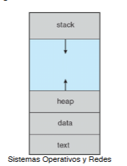
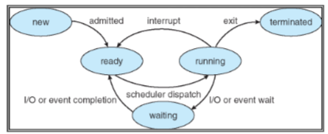
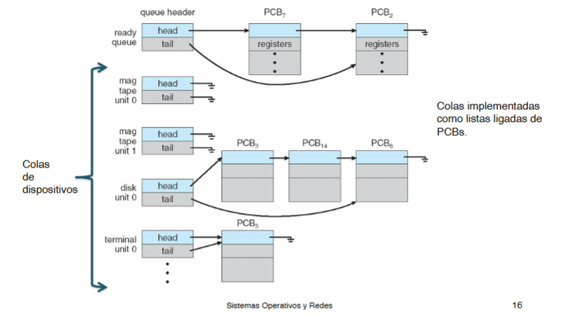
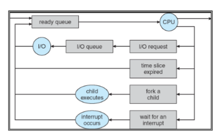
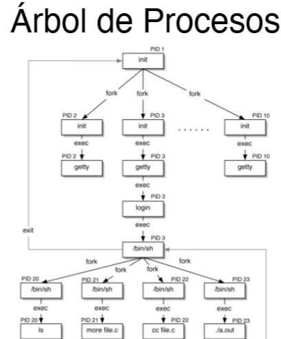
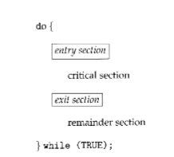
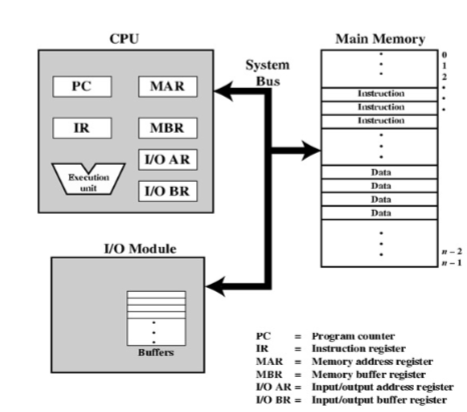
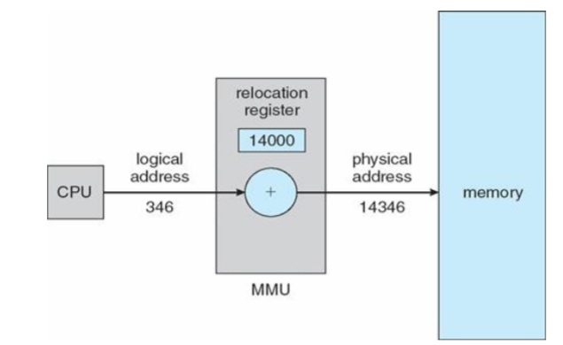

# Clase 1 

estructura de vonnoimann, ver la entrada y salidas y ver los componentes, cpu, memoria y mas o menos como funciona 


# Clase 2

## Que es un proceso?

Un proceso es un programa en ejecucion, el programa esta en la memoria, la cpu ejecuta las instrucciones y los datos tambien deberian estar en la memoria, la imagen es el objeto ejecutable despues de la compilacion guatdada en el disco, para que el proceso pueda ejecutarse debe estar guardado en la memoria primero para poder ejecutarse. Cuando el programa esta en ejecucion tiene un layout.



- texto: codigo de programa
- datos: variables globales
- stack: datos temporales
- heap: memoria asignada dinamicamente

Lo que pasa la cpu cuando de ejecuta un proceso es:
- fetch de la instruccion
- decodificacion
- ejecucion
- escritura de resultados en los registros 
- siguente instruccion y repetir

cuando un proceso esta cargado en memoria tiene un espacio de direcciones para el proceso, el tamaño del espacio depende el tamaño del bus de direcciones, osea de la arquitectura de la CPU, cuando el programa escribe en memoria queda actualizada la direccion de memoria en, puede ser operaciones de I/O. constantemente estamos creando datos en el stack y pedimos datos al heap.

### Estados de un proceso
- new: el proceso se esta creando 
- ready: el proceso esta esperando la cpu
- running: las instrucciones estan siendo ejecutadas por la CPU
- waiting: el proceso esta esperando qeu un evento ocurra, por ejemplo un I/O que se termine
- terminated: el proceso termino 

para un procesador un solo proceso puede estar ejecutandose a la vez, varios procesos pueden estar en estado ready o en waiting



### Process control block (PCB)


cada proceso esta representado en el sistema por un PCB, es el ente que permite mantener el estado de ejecucion del proceso, contiene varios datos que describen el estado de un proceso:
- process  state: new, ready, waiting ...
- program counter: indica la direccion de la siguente instruccion
- registers: dependen de la arquitectura de la CPU
- informacion de planificacion y administracion de la memoria, prioridad del proceso e informacionde la tabla de paginas 
- estado de I/O: lista de dispositivos de I/O asignados al proceso.

### Como se puede hacer que varios procesos funcionen con una sola CPU

#### Multiplexacion de CPU
Con multiprogramacion el SO mantiene varios orocesos ejecutandose en memoria, esto quiere decir que varios procesos pueden estar en estado ready esperando a estar running, solo un proceso puede estar en running por cpu, el quantum de tiempo puede ser super corto a la percepcion del usuario humano, mayor quantum a mayor prioridad, basicamente la rotacion rapida de la CPU causa la ilusion de simultaneadad.

#### Cambio de CPU entre procesos
se conoce como cambio de contexto, los PCB guardan el estado del los procesos de la informacon en los cambios de contextos, los cambios de contextos se pueden gatillar como resultado de una interrupcion por ejemplo un timer. 


## Planificaciond de un proceso 

la idea es mantener la cpu de forma ocupada de la manera mas eficiente, un planificador de procesos se encarga de elegir alguno de los procesos disponibles para que la cpu lo ejecute, la justicia de procesos es alfinal la probailidad que los procesos se ejecuten, estos procesos entran a una cola la cual contiene todos los procesos que se van a ejecutar. los procesos que residen en la memoroa principal y que estan listos entan en una cola y un queue de listo, cuando un proceso espera un I/O enytra a una cola de dispositivos, cuando sale de la cola de se dice que esta dispatch

implementacion de las colas:


la imagen muestra un tipo de colas anclando pcb's

cuando un proceso es despachado podria requerir un I/O o puede esperar un subproceso y espera la la terminacion de este por ende el proceso padre queda encolado esperando que termine, cuando termina un proceso salen de la rotacion de colas, siempre al final terminan volviendo a la cola de los listos hasta que realmente termine el proceso, cuando esta waiting o algo siempe queda encolado en algun lado



los pcb se mueven de cola en cola conforme cambian los estados del proceso 

un proceso migra entre colas en su ciclo que dependen del sistema operativo y los criterios de que proceso elige para ejecutar, hay un planificador especifico para eso 

- planificador de corto plazo (dispatcher)
- planificador de medio plazo
- planificador de largo plazo (job shceduler)

largo y corto plazo difieren en la frecuencia con la que se ejecutan, corto con mucha frecuencia y el largo con poca.

El planificador de largo plazo control a el grado de multiprogramacion en el sistema.

comportamiento de procesos, acotado por cpu el mayor tiempo es en operaciones de computo y por I/O el mayor tiempo es utilizado en operaciones I/O, si es I/O el dispatcher esta casi vacio el otro caso la cola de dispositivos permanece casi vacia.

mediano plazo: sacar procesos de la memoria para reducir la multiprogramacion

### operaciones e procesos 
#### Creacion de procesos 
un proceso puede crear nuevos procesos mediante una system call durante la ejecucion, el creador se llama padre y crea un hijo, el hijo tambien puede crear nuevos hijos y asi se crea un arbol genealogico de procesos, cada proceso tiene un id 



construir un proceso cuesta, el pcb cuesta poco recurso, copiar datos del proceso padre al hijo se llama fork() y copia exactamente el I/O y los datos y esto es costoso, fork es crear un hijo en semejanza, retorna al hijo y al padre devuelven cosas distintas osea al proceso hijo retorna un int que es el indice del proceso.


## Terminacion de un proceso 

cuando un proceso termina se le puede solicitar al SO que elimine sis doatos para liberar recursos, se usa exit()
el wait() es qeu el proceso padre espera a que el hijo termine

los threads son procesos livianos, un hilo puede crear procesos liviando, se requiere una funcion de donde partir esto, no comparten espacios de memoria, necesitan stacks distintos, lo que si sirve es que tiene paralelismo entre procesos, osea los threads pueden ejecutar procesos, se comparten datos en el heap, una lista ligada por ejemplo, por ejemplo en lectura no hay mucho problema pero en escritura si hay, ahi se va a ver 


En resumen un procesos es una abrstacciond del sistema operativo utilizada para representar todo lo que se requiere para ejecutar un programa, un programa puede tener varios o solo un hilo.


no se puede tener infinitos stacks por ende no se puede tener infinitos threads, es limitante por la memoria, un ejemplo un cliente crea una peticion y esto se crea un nuevo thread y ese thread procesa la peticion

las ventajas son:
- mejor respuesta del sistema al usuario
- facilidad de recursos compartidos
- escalabilidad: se puede aprovechar multiprocesadores

hay threads en espacio de usuario y de kernel, habia que restringir la cantidad de threads que habian, los user son threads son administrados por bibliotecas y los kernel, los user threads tienen relaciones con los user, uno a uno, uno a muchos mucho a muchos 

- muchos a uno: muchos user a uno kernel un thread accede a la vez al kernel
- uno a uno: mejor concurrencia que muchos a uno, permite paralelismo mayor costo
- mucho a mucho: se puede hacer paralelismo y ejecutar y ver que thread toma que cosa

# Clase 3
Revision de codigo de los Threads

### Create
al thread se le pasa un puntero a una funcion para que retorne y que para esa funcion tambien reciba los argumentos es una funcion void

### Join
recupera el output de un thread hijo por ejemplo, es el simil a un wait de un thread, hay concurrencia en el ejemplo de t0.c, pero basicamente lo que hacemos es crear dos threads que le pasamos una funcion main y la ejecutan.

cuando dos threads cambian una variable global puede tener un error, eso depende del sheduler y las interrupciones, si se dejan tranquilas no deberia pasar nada.

### Algoritmos de planificacion

permite el uso justo de recursos y que todos los procesos ejecuten. hay procesos que requieren mucho computo y otros que no tanto, los computadores especificamente la CPU tiene rafagas hasta que se interrumpe por una I/O.

un planificador toma una decison cuando pasa de:
- runnin a waiting (cooperativo)
- running a ready
- waiting a ready
- terminacion (cooperativo)

cuando esta el 1 y el 4 el planificador es cooperativo cuando es el segundo caso se dice que es expropiativa. En la planificacion no expropiativa una ve que la CPU toma un proceso, se mantiene hasta que la sea liberada por terminacion o por que cambia a waiting. basicamente si lo dejamos en un while infinito nunca cambia de running a waiting por lo que la CPU la tiene tomada, ese es el problema de la planificación cooperativa. Si el planificador depende de interrupciones por ejemplo un watchdog quiere decir que la planificacion es expropiativa, es más robusta esta planificacion.

la expropiativa lo que si necesita es que los procesos concurrentes con operaciones de I/O sobre informacion compartida debes sincronizarte para mantener la informacion consistente sino pasa que hay fallos como lo vimos en el ejemplo de t1.c cuando se pone un argumento muy grande.

thoughput quieres maximizar la cantidad de operaciones en cantidad de tiempo, minimizar el tiempo de completitud, minimizar el tiempo de espera cuando hay interrupciones por ejemplo, minimizar el tiempo de respuesta entre dispositivos o usuario. El criterio de justicia compartir la CPU de manera justa entre procesos.


### Algoritmos de planificación

- First-Come First-Served: Es una cola fifo (first in first out)el primero que llega es el primero que se ejecuta, los tiempo de espera son largo generalmente, se produce el efecto convoy que es basicamente que procesos cortos pueden quedar atascados por un procesos largo, es ineficiente el uso de recursos. El desempeño queda totalmente dependiente de el orden de llegada.

- Round Robin: es expropiativa, tiene un timer (time slice), cuando se cumple el time slice el planificador ve que otro proceso toma por la misma cantidad de time-slice, si el procesos termina antes del time.slice simplemente sigue corriendo otro proceso. es justo para todos los procesos, el gran problema es que se demorn en completar lso distintos procesos.

- SJF(Shortest job First): maximiza el thoughput, se necesita saber cuanta rafaga de cpu va a necesitar un proceso, el objetivo es terminar mas pronto los procesos cortos 

- SRTF: funciona bien cuando los programas tiene comportamientos predecibles 

### Planificacion por prioridad

se le asigna una prioridad de cada proceso y la CPU se le asigna elproceso con mayor prioridad, por ejemplo el SJF, el problema pueden quedar postergados indefinidamente y no se ejecutan, esto se puede corregir con una variable de envejecimiento.

### Planificacion Multinivel

se tienen varias colas de procesos (ready queue) separadas para cada categorias 
- system 
- interactive 
- interactive editing
- batch
- student

### Multi level Feedback Queue

busca optimizar el tiempo en completar el proceso y busca minimizar el tiempo de respuesta, el SO tampoco sabe a priori cuanto puede tomar en ejecutar, pero puede aprender sobre el comportamiento de los procesos a decidir como ajustar la planificacion.

- regla 1: si la proridad del proceso A es mayor que B, ejecuta A
- regla 2: si la proridad de A y B son iguales, ejecutan en Round 

- regla 3: cuando un proceso llega al sistema se pone en la de mas alta prioridad

- regla 4a: si un proceso ocupa todo el quantum de tiempo su prioridad es reducida

- regla 4b: si no ocupa todo el quantum mantiene la prioridad


cuando hay muchos procesos interactivos se bloquea ante de que termine el quantum y los procesos de larga ejecucion quedan abajo y mueren, y el vulnerable porque alguien puede mantener la alta prioridad para su proceso 

- regla 5 (priority boost): despues de un tiempo S mueve todos los trabajos a la mayor prioridad, osea se mitiga el problema de la inanicion

la tolerancia a la trampa, el procesos cuando suma un quantum completo se le baja la prioridad, al final ahi se mitiga el tema de hackeo, lleva registro de cuanto quantum a ocupado de CPU totoal  

- regla 4: "Una vez que un proceso consume su cuota total de tiempo asignada en un nivel — sin importar cuántas veces haya soltado la CPU voluntariamente antes de completarla — se le baja la prioridad."

### Comunicacion entre procesos (IPC)


hay apis para poder hacer el paso de mensajes en procesos, uno de estos es el pipe que es una tuberia digital que es un canal de comunicacion unidirecional, que es un array que un proceso escribe y el otro solo lee, se tiene identificadores de que lado se puede escribir y por donde se puede leer el pipe

named pipes que son pipes con nombres que quedan en el directorio temporal, solo se le pasa la ruta a los procesos 

Los unix domain socket son bidireccional, se puede usar como un continuo consumo de bytes o usa paquetes discretos de datos 

# Clase 4

si dos thread acceden a la misma variable global sin ni un lock, hay condicion de carrera entonces pueden chocar y puede ser erroneo.

#### Problema de la seccion critica

ubicacion del programa donde potencialmente se den condiciones de carrera.

#### Procesos cooperativos
un proceso que puede ser afectado por otro proceso ejecutandose en el sistema, pueden compartir espacios en la memoria, muy comun cuando son threads, el acceso concurrente a datos puede causar inconsistencias.

#### productor - consumidor

se involucran dos procesos ambos comparten un buffer acotado. se tiene un buffer que tiene un tamaño definido, hay un contador que ve cuantos elementos tiene el buffer, el productor solo pone datos en el buffer y la variable in que actua como el cursor del buffer, si el buffer esta lleno el while hace que espere hasta que se libere memoria. 


El productor y el consumidor comparten `buffer`, `counter`, y los cursores `in` y `out`. `in` avanza donde el productor escribe y `out` donde el consumidor lee, ambos con módulo `% BUFFER_SIZE` para dar la vuelta al arreglo (buffer circular).

```c
// Código del productor
while (true) {
    while (counter == BUFFER_SIZE)
        ; // No hace nada útil (espera)

    buffer[in] = item;
    in = (in + 1) % BUFFER_SIZE;
    counter++;
}
```

```c
// Código del consumidor
while (true) {
    while (counter == 0)
        ; // No hace nada útil (espera).

    item = buffer[out];
    out = (out + 1) % BUFFER_SIZE;
    counter--;

    // Consumir el ítem...
}
```

El problema está en `counter++` y `counter--`: ninguna de las dos es una operación atómica (cada una es leer → modificar → escribir), así que si productor y consumidor se ejecutan concurrentemente sobre `counter` sin sincronización, se produce una **condición de carrera** y el valor de `counter` queda inconsistente con el contenido real del buffer. Esa es la **sección crítica** y se resuelve con un lock / semáforo binario que garantice exclusión mutua.

Nota: el `while` de espera (`while (counter == BUFFER_SIZE) ;`) es **espera activa** o *busy waiting*: el proceso no se bloquea, se queda quemando CPU en el ciclo vacío. Es correcto pero ineficiente — la solución adecuada usa variables de condición o semáforos para que el proceso pase a estado waiting en vez de girar en vacío.

el counter toma varios pasos secuenciales para incrementar o disminuir entonces si se llega a confundir puede salir mal. la condicion de carrera es exactamente el  el orden en como se realizo el acceso, para evitar eso se tiene que hacer que solo uno acceda a la vez.

#### Solucion
cada proceso debe pedir permiso para entrar a la seccion critica mientras los otros proceso esperan para , tienen que ser ininterrumpidas los procesos.



- Exclusion Mutua: como maximo un proceso puede entrar a la seccion critica
- Ningun proceso fuera de la seccion critica puede impedir el ingreso de otro proceso 
- La espera tiene que estar acotado dentro de la seccion critica.
- eficiente 
- justo
- escalable 
- simple

#### Semaforos
es un integer que tiene operadores que son ininterrumpibles, puede partir con un cierto valor, esos operadores atomicos wait() y signal()

```c
wait(s) {
    while s <= 0;
        s--;       // entrada de la seccion critica
}
signal(s){
    s++;
}
```

`s` cuenta los permisos disponibles. `wait()` espera hasta que haya uno y lo toma (`s--`); `signal()` lo devuelve (`s++`). El código protegido va entre ambos:

```c
wait(s);
// ... seccion critica ...
signal(s);
```

Si `s` parte en 1 es un **semáforo binario**: solo un proceso entra a la vez y los demás quedan esperando en el `while` hasta que alguien haga `signal`. Equivale a un mutex y resuelve el problema del `counter` en productor-consumidor.

Lo clave es que `wait` y `signal` son **atómicas**: el SO garantiza que nadie las interrumpe a la mitad, que es justo lo que le faltaba a `counter++`.


#### Semaforos como spinlock

La definición anterior de `wait()` se basa en **espera ocupada**: el proceso se queda girando en el `while s <= 0;` hasta que otro haga `signal`. Por eso a este tipo de semáforo se le llama **spinlock** (el proceso "gira" mientras espera el lock).

- Si la espera es corta, conviene: girar unos pocos ciclos es más barato que pagar el costo de un cambio de contexto.
- Si la espera promedio es larga, es un desperdicio: el proceso consume CPU sin hacer nada útil.
- En sistemas multiprocesador los spinlocks son comunes, porque el proceso que tiene el lock puede estar corriendo en otro core y soltarlo enseguida.

#### Semaforos binarios (mutex)

Un **semáforo binario** o **mutex** es un semáforo cuyo valor solo puede ser 0 o 1. Sirve directamente para resolver el problema de la sección crítica con `n` procesos: todos comparten el mismo `mutex` inicializado en 1 y lo usan así:

```c
do {
    wait(mutex);

    // Sección crítica

    signal(mutex);

    // Código restante
} while (true);
```

El primero que llega hace `wait` y baja el mutex a 0, los demás quedan esperando; cuando el que entró hace `signal` el mutex vuelve a 1 y entra otro. Con esto se garantiza exclusión mutua sin importar cuántos procesos sean.

Si el semáforo parte en un valor `n > 1` ya no es binario sino un **semáforo contador**: deja pasar hasta `n` procesos a la vez (sirve para administrar `n` recursos iguales, como el pool de buffers).

#### Semaforos con cola (sin espera ocupada)

Para no quemar CPU girando, el semáforo se puede implementar manteniendo una **cola de procesos bloqueados**. El semáforo pasa a ser una estructura con un entero y una lista:

```c
typedef struct {
    int value;
    struct process *list;
} semaphore;
```

`wait()` ahora siempre decrementa, y si el valor queda negativo el proceso se agrega a la lista y se bloquea con `block()`, quedando "durmiente" (estado waiting, sin pedir CPU):

```c
wait(semaphore *S) {
    S->value--;
    if (S->value < 0) {
        // agregar proceso a S->list
        block();
    }
}
```

`signal()` (o `post()`) incrementa, y si todavía hay alguien esperando saca un proceso de la lista y lo despierta con `wakeup()`, que lo devuelve a la cola de listos:

```c
signal(semaphore *S) {
    S->value++;
    if (S->value <= 0) {
        // sacar proceso P de S->list;
        wakeup(P);
    }
}
```

Detalle: con esta versión el valor puede ser negativo, y su magnitud indica **cuántos procesos están esperando** en el semáforo. Esto requiere soporte de la biblioteca de threads y/o del SO, porque `block()` y `wakeup()` son primitivas del planificador.

#### Semaforos: usos indebidos

Los semáforos son una primitiva robusta, pero quedan en manos del programador y sus errores **no se detectan en tiempo de compilación**: el código compila igual y el problema aparece en ejecución, de forma intermitente. Ejemplos típicos:

```c
signal(mutex);        // invertir el orden:
// Sección crítica    // se libera antes de entrar, no hay
wait(mutex);          // exclusión mutua

wait(mutex);          // hacer wait dos veces:
// Sección crítica    // nadie hace signal, el proceso
wait(mutex);          // queda bloqueado para siempre (deadlock)
```

A esto se suman otros descuidos: olvidar el `signal` (el lock nunca se libera), o salir de la sección crítica por un `return`/excepción sin pasar por el `signal`.

La forma de prevenirlos es usar abstracciones de más alto nivel, donde la sincronización la ponga el lenguaje y no el programador: **monitores** y **variables de condición**.

#### Problema de buffer acotado 
un mutex provee exclusion mutua para acceder al pool de buffer, se necesitan dos semaforos que mantiene la cuenta empty y full.

si vemos el problema del consumidor y productor, basicamente el productor no puede producir si el buffer esta lleno, el consumidor no puede consumir si no hay que consumir.

para reslver eso es exclusion mutua entre ambos para tocar el array del buffer que no pueden escribir en el mismo, el mutex solo resuelve el problema de que no se consuma o provee al mismo timepo, no garantiza que encuentre o no datos en el array. lo que no queda resuelto es la coordinacion entre ambos. el productor tiene que esperar que este vacio y el consumidor que este lleno, para eso se ocupan dos semaforos distintos que son necesidades propias de cada proceso. El productor se queda esperando un empty, si hay entra a la seccion critica y despues le manda señanl a full, para el consumidor es mas o menos lo mismo pero manda la señal a empty.


Dicho más ordenado: acá hay **dos problemas distintos** y cada uno necesita su propio semáforo.

1. **Exclusión mutua** sobre la estructura compartida (el arreglo `buffer` y los cursores `in`/`out`): dos procesos no pueden estar manipulándola al mismo tiempo. Eso lo resuelve el `mutex` (binario, inicializado en 1).
2. **Coordinación** entre productor y consumidor: el mutex garantiza que entren de a uno, pero no garantiza que cuando entren haya algo que hacer. Al productor le puede tocar un buffer lleno y al consumidor uno vacío, y ninguno de los dos casos lo detecta el mutex.

Para lo segundo se usan dos semáforos **contadores**, uno por cada necesidad:

- `empty`: cuántos espacios libres quedan. Se inicializa en `n` (al principio todo el buffer está disponible).
- `full`: cuántos ítems hay listos para consumir. Se inicializa en `0`.

El productor hace `wait(empty)` — si no hay espacio libre se bloquea ahí mismo, sin haber tomado el mutex —, después toma el mutex, escribe el ítem, suelta el mutex y hace `signal(full)` para avisar que dejó un dato disponible. El consumidor es simétrico: `wait(full)` para asegurarse de que hay algo que sacar, toma el mutex, saca el ítem, suelta el mutex y hace `signal(empty)` para avisar que liberó un espacio. Por eso se dice que **el productor produce buffers llenos para el consumidor y el consumidor produce buffers vacíos para el productor**.

```c
// Productor                    // Consumidor
do {                            do {
    // producir un elemento         wait(full);
    wait(empty);                    wait(mutex);
    wait(mutex);
    // agregar al buffer            // sacar del buffer
    signal(mutex);                  signal(mutex);
    signal(full);                   signal(empty);
} while (true);                     // consumir el elemento
                                } while (true);
```

Ojo con el **orden de los `wait`**: primero el semáforo de conteo (`empty`/`full`) y después el `mutex`. Si se invierte, un proceso puede quedarse dormido esperando `full` *teniendo el mutex tomado*, y el otro nunca podrá entrar a liberarlo: deadlock. En los `signal` el orden no importa tanto, pero por simetría se suelta primero el mutex.

#### Problema de los lectores y escritores

sabemos que si solo hay lectores no hay problema dado que no se da condicion de carrera, solo pasa cuando hay un editor que cambia el dato. generalmente este problema se da en bases de datos cuando hay muchos datos que van cambiando. Si ponemos un mutex a los lectores hacemos un ebotellamiento que hace mas malo el codigo, hay que ver como hacerlo para que poner mutex cuando haya lector. la solucion es priorizar o los lectores y que hayan varios lectores o escritores.

Son dos semaforos los importantes, primero hay un contador de lectores que ve cuantos entran a la seccion critica. 

Ordenando la idea: el recurso compartido (la B.D.) admite **muchos lectores simultáneos**, pero un escritor necesita **acceso exclusivo** — ni otros escritores ni lectores mientras escribe. Poner un mutex simple para todos funcionaría, pero desperdicia el paralelismo natural de las lecturas.

Hay dos variantes según a quién se priorice, y **ambas pueden causar inanición**:

- **Lectores primero**: un lector nunca espera salvo que un escritor ya tenga el acceso. Si llegan lectores sin parar, el escritor puede no entrar nunca → inanición de escritores.
- **Escritores primero** ("lectores después"): si hay un escritor esperando, ningún lector nuevo entra. → inanición de lectores.

La solución clásica (lectores primero) usa tres cosas compartidas:

```c
semaphore mutex, wrt;  // ambos inicializados en 1
int readcount;         // inicializado en 0
```

- `readcount`: cuántos lectores hay adentro en este momento.
- `mutex`: protege las modificaciones de `readcount` (también es una sección crítica).
- `wrt`: da la exclusión real sobre la B.D. Lo usan los escritores entre sí, y del lado de los lectores lo toma **solo el primero que entra** y lo suelta **solo el último que sale**. Los lectores del medio no lo tocan, por eso pueden leer todos juntos.

```c
// Escritor                     // Lector
do {                            do {
    wait(wrt);                      wait(mutex);
                                    readcount++;
    // se hace la escritura          if (readcount == 1) wait(wrt);
                                    signal(mutex);

    signal(wrt);                    // se hace la lectura
} while (true);
                                    wait(mutex);
                                    readcount--;
                                    if (readcount == 0) signal(wrt);
                                    signal(mutex);
                                } while (true);
```

La idea clave es el `if`: el primer lector "cierra la puerta" a los escritores en nombre de todos, y el último la abre. Si un escritor está adentro y llegan `n` lectores, uno queda encolado en `wrt` y el resto en `mutex`; cuando se libera `wrt`, es el **planificador** el que decide si sigue un lector o el escritor que esperaba.

Este patrón está generalizado en los **locks lector-escritor** (`rwlock`): al pedir el lock se declara el modo, lectura (compartido, varios a la vez) o escritura (exclusivo, uno solo). Tienen más overhead que un mutex normal, pero conviene cuando hay muchos más lectores que escritores.

# Clase 5

#### Locks
solucion al problema de seleccion critica requiere un cerrojo, un procesos debe adquirir un lock antes de ingresar a una seccion critica, libera el lock cuando deja la seccion critica.
Una de las soluciones es habilitar o deshabilitar las interrupciones para que no haya expropiación, esto no es una solucion robusta, sobretodo en multiprocesadores. Para solucionar esto es un set de instrucciones atomicas.

##### Test and Set
Los Test and Set, se le pasa una direccion de memoria setea esa direccion y devuelve lo que habia ahi. 

```c

// spinlock
bool TestAndSet(bool *target){
    bool rv = *target;
    *target = true;
    return rv;
}
bool lock = false;

while(true){
    while(TestAndSet(&lock));
    // sección critica
    lock = false;
    //resto del código
}

```


##### Resumen: spinlock

Un **spinlock** es un lock donde el proceso que no puede entrar a la sección crítica no se bloquea ni se va a `waiting`: se queda "girando" en un loop (`while`) revisando la condición una y otra vez hasta que se libera. Ya lo habíamos visto con el semáforo de espera ocupada (`wait(s) { while (s <= 0); s--; }`), y acá `TestAndSet` es la forma real de implementarlo con hardware:

- `TestAndSet(&lock)` es **una sola instrucción atómica**: lee el valor de `lock`, lo pone en `true`, y devuelve el valor que tenía *antes* — todo sin que otro procesador pueda meterse en el medio. Esa atomicidad de hardware es la que reemplaza (de forma robusta) al truco de deshabilitar interrupciones.
- El `while(TestAndSet(&lock));` es el spinlock: mientras `lock` ya estaba en `true` (otro proceso lo tiene tomado), sigue devolviendo `true` y el loop no avanza. Cuando el que tenía el lock hace `lock = false`, la siguiente llamada a `TestAndSet` encuentra `false`, lo setea en `true`, retorna `false` (sale del `while`) y ese proceso entra a la sección crítica.

En corto: **gira en vez de dormir**. Conviene cuando la espera esperada es corta (más barato que un cambio de contexto) y es el mecanismo típico en multiprocesadores, donde el que tiene el lock puede estar corriendo en otro core y soltarlo pronto. Si la espera es larga, conviene una solución que bloquee al proceso (como el semáforo con cola que vimos antes) en vez de desperdiciar CPU girando.


#### Swap
intercambias dos palabras en memoria al igual que el anterior se ejecutan de manera atomica.

```c
// SWAP
bolean Swap(bool *a, bool *b){
    bool temp = *a;
    *a = *b;
    *b = temp;
    return temp;
}

while(true){
    key = true;
    while(Swap(&key, &lock));
    // sección critica
    lock = false;
    //resto del código
}
```

Cuando hay unsa solucion de lock es que hay exclusion mutua, hay justicia y hay que revisar que un thread no se quede esperando indefinidamente, que no haya inanicion. Para eso hay que poner un timer que lo saque de la seccion critica y que vuelva a entrar, eso es lo que hace el algoritmo de Peterson.


#### Variables de condicion
Es una especie de cola que permite a un thread avisar a otros que una condicion del sistema ha cambiado. hay dos semanticas 

# Clase 6 

#### Bloqueo mutuo 


##### Procesos y recursos (slide 35)

Un sistema es un conjunto **finito** de recursos que hay que repartir entre varios procesos que compiten por ellos. Los recursos se agrupan en **clases**: espacio de memoria, ciclos de CPU, núcleos de CPU, archivos, dispositivos de E/S.

La idea clave de "clase" es que **las instancias dentro de una clase son intercambiables**: si un proceso pide un recurso de la clase, cualquier instancia de esa clase le sirve. Si no fuera así (si al proceso le sirve una instancia y no otra), significa que la clase está mal definida y hay que separarla en clases distintas.

##### Patrón de utilización de recursos (slide 36)

Todo uso de un recurso sigue siempre la misma secuencia de tres pasos:

1. **Solicitud:** el proceso pide el recurso. Si no se le puede conceder de inmediato (lo tiene otro), el proceso **debe esperar**.
2. **Uso:** el proceso opera con el recurso.
3. **Liberación:** el proceso lo suelta, y recién ahí queda disponible para asignarse a otro proceso.

Es el mismo patrón de `lock` / sección crítica / `unlock` que veníamos viendo, pero generalizado a cualquier recurso del sistema. El paso 1 es donde nace el problema: ahí es donde un proceso se queda esperando, y si varios se quedan esperando "en círculo" aparece el bloqueo mutuo.

##### Caracterización de un bloqueo mutuo (slide 37)

En un **bloqueo mutuo (deadlock)** los procesos involucrados **nunca terminan de ejecutar** y, como nunca terminan, **nunca liberan los recursos** que tienen tomados. El sistema se degrada: esos recursos quedan retenidos para siempre y ni siquiera se pueden iniciar procesos nuevos que los necesiten.

Para que exista un bloqueo mutuo se tienen que dar **las cuatro condiciones al mismo tiempo** (son condiciones *necesarias*):

1. **Exclusión mutua:** al menos un recurso es no compartible, o sea sólo un proceso a la vez puede usarlo. Si varios lo piden, los demás esperan.
2. **Toma y espera (hold and wait):** un proceso tiene al menos un recurso **en su poder** y al mismo tiempo **está esperando** por otro(s) que están asignados a otros procesos.
3. **No expropiación:** los recursos no se pueden quitar por la fuerza; un recurso sólo se libera cuando el proceso que lo tiene lo suelta **voluntariamente**.
4. **Espera circular:** existe un conjunto de procesos {P0, P1, …, Pn} tal que P0 espera un recurso que tiene P1, P1 espera uno que tiene P2, …, Pn-1 espera uno que tiene Pn, y Pn espera uno que tiene P0. El ciclo se cierra.

Que las cuatro sean **necesarias** es lo importante en la práctica: basta con **romper una sola** para que el deadlock no pueda ocurrir. En eso se basan los protocolos de prevención (p. ej. pedir todos los recursos al inicio rompe "toma y espera", o imponer un orden total de recursos rompe la "espera circular").


### Memoria

#### Recordatorio
arquitectura de Von Neumann, se hace el fetch a la memoria, luego la decodificacion y luego se ejecuta la instruccion. 


### Hardware

La memoria principal y registros de la CPU, es la unica memoria que la CPU puede acceder directamente, con esto salen dos problemas principales:
- diferencial de acceso: puede producir una condición de stall, esto quiere decir que que la CPU no tiene disponible la data necesesaria para terminar de ejecutar la instruccion, se puede dar porque algun dato esta en la memoria principal y no en los registros de la CPU, la solucion es el cache.

- El otro problema es la seguridad de la memoria, defender que los procesos no se metan al kernel los procesos de usuarios. Todo proceso debe tener un espacio de memoria separado y propio, se tiene que definir previo cuanto espacio de memoria se le asigna a cada proceso, esto es lo que se llama proteccion de memoria (definir el rango de direcciones validas de cada proceso). Se usa una pareja de registros para estos fines, el registro base y el registro limite. 

### Espacio Fisico vs Logico 

ven un espacio de deirecciones contiguo, exclusivo y grande, esto requiere que traducciones de direcciones.
- direcciones logicas: son las direcciones que ve el proceso, son virtuales y no necesariamente contiguas, se tiene que traducir a direcciones fisicas. Generada por la CPU.
- direcciones fisicas: son las direcciones que ve la memoria principal, son contiguas y exclusivas, generadas por la memoria principal. Vistas por la MMU

La MMU es la parte que ve las direcciones y traduce de virtuales a fisicas. se tiene un registro de relocalizacion.



### Direcciones de memoria 


Un programa parte guardado en disco como un binario ejecutable. Para poder correr, se tiene que cargar a memoria fisica, y no necesariamente termina en la direccion 0 — la asociacion entre las instrucciones/datos del programa y las direcciones de memoria reales se puede hacer en distintos momentos:

- **En tiempo de compilacion:** se sabe de antemano en que direccion va a quedar el proceso, entonces el compilador genera directamente direcciones absolutas. Es el caso mas restrictivo, porque si cambia la direccion de carga hay que volver a compilar.
- **En tiempo de carga:** si no se sabe donde va a quedar el proceso al compilar, el compilador genera codigo **relocalizable** (con direcciones relativas). La asociacion definitiva a direcciones fisicas se hace recien cuando el *loader* carga el programa en memoria.
- **En tiempo de ejecucion:** el proceso se puede mover de un segmento de memoria a otro mientras esta corriendo. Requiere hardware especial (el registro de relocalizacion / la MMU) para ir traduciendo direcciones sobre la marcha — es el esquema que usamos con el registro base y limite.

Esto conecta con el flujo completo de un programa: el codigo fuente se compila a un modulo objeto (**compile time**), el *linkage editor* lo junta con otros modulos objeto y bibliotecas para formar el modulo de carga (**load time**), y el *loader* finalmente lo deja como imagen binaria en memoria (**execution/run time**).

#### Carga dinamica

En vez de cargar todo el programa de una vez, las rutinas se van cargando a medida que se necesitan — todas quedan en disco con direcciones relocalizables hasta que se usan. Sirve mucho para bibliotecas grandes donde solo se usa una fraccion del codigo, porque no se desperdicia memoria en rutinas que nunca se llaman. No requiere soporte especial del sistema operativo: es el programador quien tiene que disenar el programa para aprovechar esta tecnica (aunque el S.O. puede dar funciones de apoyo).

#### Enlace dinamico y bibliotecas compartidas

Un programa normalmente depende de bibliotecas (la estandar de C, llamadas al sistema, etc.). Hay dos formas de enlazarlas:

- **Enlace estatico:** al cargar el programa, el *loader* combina el binario con las bibliotecas de las que depende, y todo queda cargado en memoria junto.
- **Enlace dinamico:** el enlace se posterga hasta tiempo de ejecucion (es el mismo principio que la carga dinamica, pero aplicado a bibliotecas). Se usa un **stub** que referencia la rutina de la biblioteca; cuando se ejecuta el stub, si la rutina no esta en memoria, recien ahi se carga.

La ventaja grande del enlace dinamico es que el codigo de una biblioteca cargado en memoria se puede **compartir entre varios procesos** que la necesiten, en vez de tener una copia por proceso. Ademas permite tener varias versiones de una misma biblioteca cargadas al mismo tiempo, cada proceso usando la que le corresponde.


### Asignaciones de memoria

En memoria principal tiene que caber tanto el sistema operativo como los procesos de usuario. Generalmente se parte la memoria en dos: una porcion para el S.O. (que puede quedar en "memoria baja" o "memoria alta", segun donde este el vector de interrupciones) y otra para los procesos de usuario. Con multiprogramacion queremos varios procesos de usuario en memoria al mismo tiempo, asi que hay que decidir como repartirles la memoria disponible — el mecanismo mas usado es la **asignacion contigua de memoria**.

#### Asignacion contigua

- **Particiones fijas:** se divide la memoria en particiones de tamano fijo, cada una con exactamente un proceso adentro. El grado de multiprogramacion queda limitado por el numero de particiones. Cuando un proceso termina, libera su particion para que entre otro. Es el esquema de "particiones multiples" (lo uso originalmente el IBM OS/360).
- **Particiones variables:** el S.O. mantiene una tabla con que partes de memoria estan libres ("hoyos") y cuales ocupadas. Al principio toda la memoria de usuario es un solo hoyo grande; a medida que entran y salen procesos la tabla se va actualizando. Si no cabe un proceso en ningun hoyo disponible, tiene que esperar a que se libere memoria.

Con particiones variables aparece el problema de **como elegir el hoyo** donde meter un proceso de tamano *n*. Hay tres estrategias:

- **Primer calce (first fit):** se agarra el primer hoyo que alcance. La busqueda puede partir del inicio, del final, o de donde quedo la ultima busqueda. Apenas encuentra uno suficientemente grande, para ahi.
- **Mejor calce (best fit):** se agarra el hoyo mas chico que alcance, dejando el menor desperdicio posible. Hay que revisar toda la lista (a menos que este ordenada por tamano).
- **Peor calce (worst fit):** se agarra el hoyo mas grande disponible, para que el resto que sobra sea un hoyo grande y util. Tambien hay que recorrer toda la lista.

Segun simulaciones, primer y mejor calce le ganan a peor calce en uso del espacio.

#### Fragmentacion de memoria

Hay dos tipos de fragmentacion, y conviene no confundirlas:

- **Fragmentacion externa** (la que trae la clase): a medida que procesos entran y salen, la memoria libre se va rompiendo en pedazos chicos. Pasa cuando *sí* hay memoria total suficiente para una solicitud, pero no esta junta (no es contigua), entonces no se puede aprovechar. Es tipica de particiones **variables**. Es como estacionar autos: puede que sobre espacio en el estacionamiento, pero repartido en pedacitos donde no entra un auto mas.
- **Fragmentacion interna** (no la vimos en la clase, pero es el concepto complementario): pasa cuando a un proceso se le asigna **mas** memoria de la que en realidad necesita, y ese sobrante queda pegado a su particion sin que nadie mas lo pueda usar — es memoria "gastada" que esta libre pero inaccesible. Es tipica de particiones **fijas**: si el proceso es mas chico que la particion, el resto de esa particion se desperdicia.

En corto: la externa es memoria libre repartida en trozos muy chicos entre procesos; la interna es memoria libre pero atrapada dentro de la particion de un solo proceso.

Una solucion es la **compactacion**: mover las particiones ocupadas para que toda la memoria libre quede junta en un solo bloque grande. El algoritmo tipico es empujar todos los procesos hacia uno de los extremos de la memoria, dejando los hoyos juntos en el otro extremo. El problema es que no siempre se puede: requiere relocalizacion dinamica en tiempo de ejecucion (mover el programa y sus datos, y actualizar el registro base), lo cual es caro.

La otra solucion, mas usada hoy en dia, es directamente permitir que un proceso **no** ocupe memoria fisica contigua — cargarlo donde sea que haya espacio libre. Para esto se necesitan dos mecanismos: **segmentacion** y **paginacion**.

### Segmentacion de memoria

La pregunta de fondo: ¿como ve la memoria el programador en realidad? No la ve como un arreglo lineal de bytes, la ve como una coleccion de pedazos de tamano variable sin un orden necesario entre ellos — el codigo, las variables globales, el heap, la pila, etc. Cada uno de estos pedazos es un **segmento**. Los elementos dentro de un segmento se identifican por su **desplazamiento** dentro de ese segmento.

En este esquema, llamado **segmentacion**, el espacio de direcciones logicas es una coleccion de segmentos, cada uno con nombre (o numero) y largo. Una direccion logica es entonces una tupla:

`<numero-de-segmento, desplazamiento>`

Cuando un programa de C compila, el compilador genera automaticamente segmentos para: el codigo, las variables globales, el heap, la pila de cada thread, y la biblioteca estandar de C. Las bibliotecas externas enlazadas en forma estatica reciben sus propios segmentos aparte.

#### Hardware de segmentacion

Para traducir una direccion logica `<s, d>` a una direccion fisica se usa la **tabla de segmentos**: tiene una entrada por cada segmento, y cada entrada guarda la **base** (donde empieza el segmento en memoria fisica) y el **limite** (el largo del segmento). El hardware:

1. Usa `s` para buscar la entrada del segmento en la tabla.
2. Valida que `d < limite` — si no, lanza un *trap* de error de direccionamiento (el proceso se esta saliendo de su segmento).
3. Si es valido, calcula la direccion fisica como `base + d`.

Es la misma logica del registro base/limite que vimos antes, pero ahora hay **una pareja base/limite por segmento**, no una sola para todo el proceso.

**Ejemplo** (de la clase): el segmento 2 tiene limite 400 y base 4300.
- Referencia al byte 53 del segmento 2 → `4300 + 53 = 4353` (valido, 53 < 400).
- Referencia al segmento 3, byte 852, con base 3200 → `3200 + 852 = 4052`.
- Referencia al byte 1222 del segmento 0, cuyo limite es 1000 → **trap**, porque 1222 > 1000.

#### Ventajas y limitaciones

La traduccion es simple: solo aritmetica basica (sumar base + desplazamiento) mas la validacion contra el limite. Pero la segmentacion **no resuelve la fragmentacion**:

- Sigue sufriendo fragmentacion externa (los segmentos, como los procesos en asignacion contigua, dejan hoyos al entrar y salir de memoria) — la compactacion sigue siendo cara.
- Los segmentos pueden ser arbitrariamente grandes. Si un segmento es enorme y solo se usa una parte pequenia de el, no tiene mucho sentido mantenerlo completo en memoria.

Estos dos problemas son los que resuelve la **paginacion** (paging), que se ve despues.


### Paginacion de memoria

La paginacion es un esquema de administracion de memoria que permite que el espacio de direcciones **fisicas** de un proceso no sea contiguo. Previene la fragmentacion externa y la necesidad de compactacion — es el esquema que usa la mayoria de los S.O. modernos.

#### Metodo basico

Se rompe la memoria fisica en bloques de tamano fijo llamados **marcos** (*frames*), y la memoria logica tambien se rompe en bloques del mismo tamano, llamados **paginas**. Cuando un proceso ejecuta, sus paginas se cargan en los marcos disponibles (no necesitan ser contiguos). Si se usa swapping, el almacenamiento no volatil (disco) tambien se divide en bloques del mismo tamano.

Cada direccion logica generada por la CPU se descompone en dos partes:

`<numero-de-pagina (p), desplazamiento (d)>`

`p` se usa como indice en la **tabla de paginas** del proceso, ahi se obtiene el numero de marco `f` donde esta esa pagina en memoria fisica. La direccion fisica final se arma como `f` + `d` (el marco encontrado, con el mismo desplazamiento `d`).

El tamano de pagina (= tamano de marco) lo define el hardware y siempre es una **potencia de 2** (entre 512 bytes y 16 MB tipicamente, segun la arquitectura). Esto hace la traduccion trivial: si el espacio de direcciones logicas es `2^m` y la pagina tiene `2^n` direcciones, los `m - n` bits mas altos de la direccion son el numero de pagina y los `n` bits mas bajos son el desplazamiento — no hay que hacer una suma como en segmentacion, solo hay que "cortar" la direccion en dos partes de bits.

#### Fragmentacion en paginacion

Con paginacion se evita la fragmentacion **externa**: como cualquier marco libre sirve para cualquier pagina, no quedan hoyos inutilizables entre procesos.

Pero puede aparecer fragmentacion **interna**: si la memoria que el proceso realmente usa no es un multiplo exacto del tamano de pagina, la ultima pagina queda parcialmente desperdiciada. En el peor caso, un proceso podria tener un solo byte ocupado en su ultima pagina y desperdiciar `2^n - 1` bytes. Si el tamano de proceso es independiente del tamano de pagina, se espera en promedio **media pagina** de fragmentacion interna por proceso — lo que sugiere que paginas chicas son mejores para esto. Pero paginas chicas van en contra de la eficiencia de disco (que es mejor mientras mas grande la transferencia), asi que es un trade-off. Algunos S.O. (como Solaris) soportan paginas de tamano variable (8KB a 4MB) para balancear esto.

El S.O. mantiene ademas una **tabla de marcos**: una entrada por cada marco de memoria fisica indicando si esta libre o asignado, y a que pagina/proceso pertenece si esta ocupado.

#### Soporte de hardware: PTBR y TLB

La tabla de paginas de cada proceso se mantiene en memoria principal (en sistemas actuales puede tener millones de entradas — ej: memoria de 4GB con paginas de 4KB ≈ 1 millon de entradas). Un registro especial, el **PTBR** (*Page Table Base Register*), apunta a donde empieza la tabla de paginas del proceso en ejecucion. En un cambio de contexto, basta con cambiar el valor del PTBR.

El problema es de **rendimiento**: acceder a una direccion logica requiere primero un acceso a memoria para leer la tabla de paginas (encontrar el marco), y despues *otro* acceso a memoria para leer/escribir el dato — el doble de lento.

La solucion estandar es la **TLB** (*Translation Look-aside Buffer*): una cache asociativa de alta velocidad con pocas entradas (64 a 1024), donde cada entrada es un par `(numero de pagina, numero de marco)`. Cuando la CPU genera una direccion logica, se compara el numero de pagina contra **todas** las llaves del TLB simultaneamente:

- **TLB hit**: se encuentra la llave, se obtiene el marco de inmediato y se arma la direccion fisica sin tocar la tabla de paginas.
- **TLB miss**: no esta, hay que ir a la tabla de paginas en memoria, y de paso se actualiza el TLB con esa traduccion para la proxima vez. Si el TLB esta lleno hay que elegir una entrada para reemplazar (aleatorio, LRU, etc.); algunas entradas (como las del kernel) se pueden fijar para que nunca se reemplacen.

El porcentaje de veces que la traduccion se encuentra en el TLB es la **tasa de acierto** (*hit ratio*). Con eso se calcula el **tiempo efectivo de acceso a memoria** (TEA), ponderando el caso hit y el caso miss por sus probabilidades:

**Ejemplo de la clase:** TLB tarda 20ns, memoria tarda 100ns.
- Con hit: `20 + 100 = 120 ns`.
- Con miss: `20 + 100 + 100 = 220 ns` (se busca en TLB, no esta, se va a la tabla de paginas en memoria, y despues a memoria de nuevo por el dato).
- Con hit ratio 80%: `TEA = 0.8×120 + 0.2×220 = 140 ns`.
- Con hit ratio 98%: `TEA = 0.98×120 + 0.02×220 = 122 ns`.

Mientras mas alto el hit ratio, mas se acerca el TEA al tiempo de un solo acceso a memoria (100ns) — por eso el TLB es tan critico para el rendimiento.

#### Proteccion de memoria con paginacion

Se logra con **bits de proteccion** en cada entrada de la tabla de paginas (asociados al marco): por ejemplo un bit que indique si la pagina es solo lectura o lectura-escritura (se puede extender a mas permisos, incluyendo solo-ejecucion). Cada vez que se traduce una direccion, se chequean los permisos; si se intenta escribir una pagina de solo lectura, se gatilla un **trap** de violacion de acceso.

Ademas se usa el **bit de validez-invalidez** en cada entrada: marca si esa pagina es una direccion legitima del proceso o no. Esto es necesario porque el espacio de direcciones asignado a un proceso normalmente no llena exactamente un numero entero de paginas — puede quedar un resto de la ultima pagina "valida" que en realidad no le pertenece al proceso, y ese bit evita que se acceda a esa zona.

#### Paginas compartidas

Una ventaja grande de la paginacion es que facilita que varios procesos **compartan** paginas de codigo — util en ambientes de tiempo compartido, donde varios usuarios corren instancias del mismo programa y todas comparten las paginas de codigo (cada proceso mantiene su propia tabla de paginas, pero varias entradas de tablas distintas apuntan al **mismo marco fisico**). Para que esto sea seguro, el codigo compartido debe ser **reentrante** (o "puro"): codigo que nunca se modifica a si mismo durante su ejecucion. Los datos, stack, heap y registros de cada proceso siguen siendo independientes — solo el codigo se comparte.

#### Tablas de pagina jerarquicas

Con espacios de direcciones de 32 o 64 bits, la tabla de paginas de un solo nivel se vuelve enorme. Ejemplo: direcciones de 32 bits + paginas de 4KB → `2^32 / 2^12 ≈ 1 millon` de entradas; con 4 bytes por entrada, hasta 4MB solo para la tabla de paginas de **un** proceso.

La solucion es **paginar la tabla de paginas** (estructura jerarquica en dos o mas niveles). Con dos niveles, la direccion logica se parte en tres campos en vez de dos: `p1` (indice en la tabla de paginas externa / "directorio"), `p2` (indice en la tabla de paginas interna que esa entrada de `p1` apunta) y `d` (desplazamiento). Por ejemplo con 32 bits: 10 bits para `p1`, 10 bits para `p2`, 12 bits para `d`. La traduccion ahora requiere dos saltos por tabla en vez de uno (mas el TLB para no pagar ese costo cada vez).

#### Caso de estudio: Intel Pentium

El Pentium soporta segmentacion pura o **segmentacion con paginacion** combinadas: una direccion logica pasa primero por la unidad de segmentacion (que la convierte en una direccion **lineal**), y esa direccion lineal pasa por la unidad de paginacion (que la convierte en la direccion **fisica** final). Juntas, ambas unidades forman la MMU.

- Un segmento puede llegar a 4GB, y hay hasta 16.384 segmentos por proceso: 8.192 privados del proceso (tabla **LDT**, *Local Descriptor Table*) y 8.192 compartidos entre todos los procesos (tabla **GDT**, *Global Descriptor Table*).
- La direccion logica es un par `<selector, desplazamiento>`. El selector (16 bits) trae el numero de segmento (13 bits, hasta 8192), un bit que dice si el segmento esta en la GDT o la LDT, y 2 bits de proteccion.
- El selector se usa para buscar el **descriptor de segmento** (base + limite), que sumado al desplazamiento da la direccion **lineal** de 32 bits.
- Para paginar esa direccion lineal, el Pentium soporta paginas de 4KB o 4MB (definido por el registro **CR3**, que apunta al **Directorio de Paginas** del proceso, y un flag *Page Size* en el directorio). Con paginas de 4KB se usa un esquema de dos niveles: 10 bits para el directorio de paginas, 10 bits para la tabla de paginas interna, 12 bits de desplazamiento. Con paginas de 4MB el directorio apunta directo al marco: 10 bits para el marco, 22 bits de desplazamiento.

### Memoria virtual

Hasta ahora asumimos que **todo** el codigo de un proceso debe estar en memoria fisica para ejecutar. Pero la memoria fisica es un recurso escaso, y no siempre tiene sentido mantener ahi codigo que casi nunca se ejecuta, o estructuras de datos sobredimensionadas que nunca se usan a maxima capacidad.

La idea de la **memoria virtual** es dejar que un proceso ejecute aunque solo una **porcion** de el este en memoria fisica en un momento dado. Ventajas:

- El proceso ve un espacio de direcciones virtuales que puede ser **mas grande** que la memoria fisica disponible — deja de estar limitado por ella.
- Como cada proceso consume menos memoria fisica real, se puede subir el grado de multiprogramacion → mejor utilizacion de CPU y throughput, sin necesariamente empeorar el tiempo de respuesta.
- Ya no hace falta hacer swap de procesos **completos**: los intercambios entre memoria y disco pueden ser parciales (pagina por pagina).

El espacio virtual sigue viendose **contiguo** para el proceso (como ya vimos: codigo, datos, heap creciendo hacia arriba, stack creciendo hacia abajo, con un "agujero" grande entre ambos) — los marcos fisicos se van asignando solo conforme realmente se necesitan.

La memoria virtual tambien permite compartir paginas entre procesos (bibliotecas compartidas, comunicacion entre procesos via memoria compartida, y acelerar la creacion de procesos con `fork()` porque al principio padre e hijo pueden compartir las mismas paginas).

#### Paginacion por demanda

Es el mecanismo detras de la memoria virtual: las paginas se cargan **solo cuando se necesitan** (nunca se cargan las que no se usan). Es parecido al swapping tradicional, pero en vez de intercambiar el proceso completo, se hace **swapping flojo** (*lazy swapping*): un "paginador flojo" solo trae una pagina a memoria cuando efectivamente se requiere.

#### Faltas de pagina (page faults)

Se usa el bit de validez-invalidez (el mismo de antes) para marcar en la tabla de paginas cuales paginas estan realmente cargadas en memoria fisica. Si la CPU genera una direccion logica que cae en una pagina marcada como invalida (no cargada), ocurre una **falta de pagina** (*page fault*). El manejo estandar es:

1. Se revisa una tabla interna en el PCB para ver si la referencia es valida para el espacio de direcciones del proceso.
2. Si **no** es valida (el proceso esta accediendo fuera de lo que le corresponde) → el S.O. termina el proceso.
3. Si **si** es valida pero la pagina simplemente no esta cargada → el hardware gatilla un trap, y:
   - El S.O. busca un marco disponible.
   - Programa una operacion de disco para traer la pagina faltante a ese marco.
   - Actualiza el bit de validez-invalidez de esa entrada a "valida".
   - Se reinicia (no se continua, se **reintenta**) la instruccion que causo el trap — ahora la pagina ya esta ahi y la instruccion completa normalmente, como si nunca hubiera fallado.
