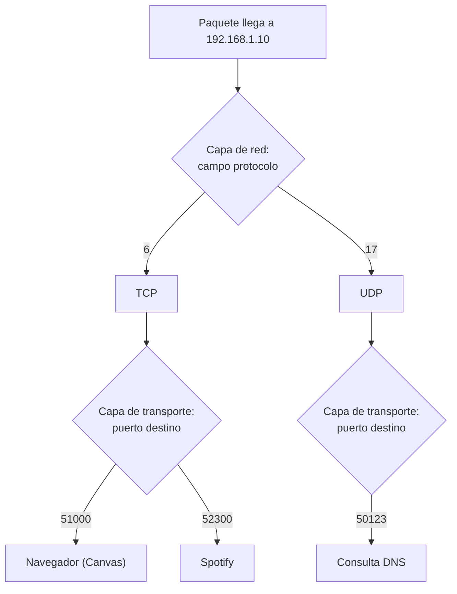
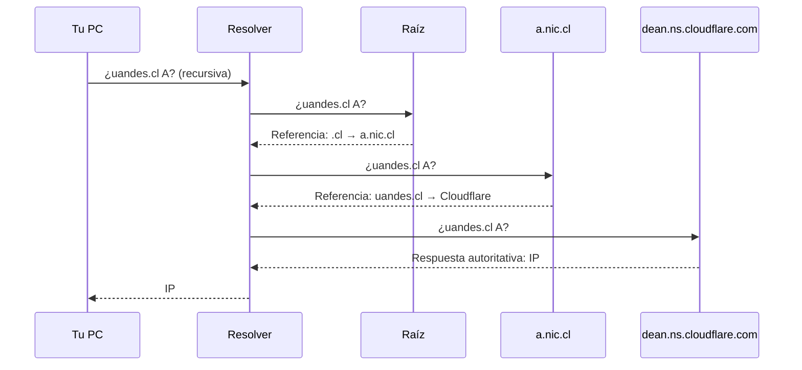

# Resumen P4 · Parte 1 · DNS

> Libro: secciones 2.5 y 3.2 (+ MX en 3.3). Apunte «Registros DNS»: secciones 1 a 8.

---

## 1. Direcciones, nombres e indirección (libro 2.5)

**Multiplexación en dos niveles.** Un host tiene una sola IP, pero muchos procesos usan la red al mismo tiempo.
- **Capa de red:** el campo *protocolo* del encabezado IP dice a qué transporte va el segmento (6 = TCP, 17 = UDP).
- **Capa de transporte:** el **puerto** dice a qué proceso se entrega.



**El nombre como indirección.** Igual que una variable en un programa: la dirección puede cambiar y el nombre se mantiene. *Solo los nombres son estables.*

**hosts.txt.** Un solo archivo con todos los pares nombre-IP, mantenido por el NIC (SRI). Cada host lo descargaba periódicamente.
No escala: tamaño, tráfico de descargas, una sola oficina para todos los cambios, demora en ver hosts nuevos y colisiones de nombres.

**Plano vs. jerárquico.**
- **Plano:** cada nombre es único en todo el mundo (`UCLA-CS`, «jerarquía del pobre»).
- **Jerárquico (árbol):** el nombre solo es único entre hermanos (`www.uandes.cl` y `www.uchile.cl`). Cada nodo puede **delegarse** a otro administrador.

**TLD:** cuelgan directo de la raíz.

| Tipo | Ejemplos |
|---|---|
| El primero | `.arpa` |
| Genéricos (1984) | `.com` `.edu` `.gov` `.mil` `.org` |
| De país (ISO 3166) | `.cl` `.fr` `.tv` |

- **ICANN** decide **qué TLD existen** (genéricos y de país) y a quién se entrega cada uno.
- **Cada TLD** lo administra una organización con sus propias reglas. `.cl` → NIC Chile.

**Sintaxis (BNF, RFC 1035).** Un nombre es una lista de **etiquetas separadas por puntos**. Cada etiqueta empieza con letra, termina con letra o dígito, y al medio puede tener letras, dígitos o guiones. Se lee de **específico a general**, con la **raíz implícita** al final: `www.uandes.cl.`

---

## 2. Cómo funciona la resolución (libro 2.5)

**DNS** = base de datos **distribuida**, cliente-servidor. Cada servidor guarda solo su parte.

**Qué sabe el servidor de un dominio:**
1. la IP de los hosts **directos** de su dominio;
2. **quién atiende** a sus subdominios **directos** (nunca a los nietos).

Si no sabe la respuesta, entrega una **referencia**: «no sé, pregúntale a este».

**Servidores raíz:** conocen los servidores (y sus IP) de **todos los TLD**. Son 13 nombres (`a`…`m.root-servers.net`), replicados por el mundo.

**Resolver:** servidor que resuelve por un grupo de clientes (tu ISP, la U o `8.8.8.8`). Tiene configurada la **lista de IP de los servidores raíz** (*root hints*), pero no la zona raíz.

| Consulta | Entre | Qué se pide |
|---|---|---|
| **Recursiva** | PC → resolver | «Dame la respuesta final» |
| **Iterativa** | Resolver → raíz, TLD, autoritativo | «Dime lo que sepas» (respuesta o referencia) |



La pregunta es **siempre la misma** (el nombre completo). Lo que cambia es **a quién** se le hace.

**Ventajas del resolver:** los hosts no necesitan la lista de la raíz, envían una sola consulta y comparten una **caché** (el primero hace el recorrido completo y los demás reciben la respuesta al instante).

**Beneficios de usar nombres:**
- **Mover un servidor:** solo se cambia el registro.
- **1 nombre → varias IP:** reparto de carga (al azar, el menos cargado o el más cercano).
- **Varios nombres → 1 IP:** muchos sitios pequeños en un mismo servidor.

---

## 3. El protocolo DNS (libro 3.2)

**Transporte:** **UDP** puerto 53 para lo corto (casi todo) y **TCP** puerto 53 para respuestas largas.

**Mensaje: 5 secciones** (consulta y respuesta usan el mismo formato).

| Sección | Contenido |
|---|---|
| Header | ID, flags y 4 contadores |
| Question | Qué se pregunta (`uandes.cl IN A`) |
| Answer | La respuesta (vacía en una consulta) |
| Authority | Servidores autoritativos (NS) |
| Additional | Extra útil, por ejemplo el **glue** |

**Header (12 bytes):**
- **ID (16 bits):** aleatorio, el servidor lo copia en la respuesta para emparejarlas. ID y puerto aleatorios protegen contra el **envenenamiento de caché**.
- **QR:** 0 = consulta, 1 = respuesta.
- **AA:** 1 si quien responde **tiene la zona** (es la fuente oficial). Un resolver siempre responde AA = 0, y la raíz o el TLD también cuando dan una referencia.
- **RD:** el cliente pide recursión. **RA:** el servidor la ofrece.
- **RCODE:** `NOERROR`, `NXDOMAIN` (el nombre no existe), etc.

**Cómo reconocer la respuesta:**
- **Referencia** = Answer vacía + NS en Authority (+ glue en Additional).
- **Autoritativa** = datos en Answer + AA = 1.

**Registro de recurso (RR):** `nombre  TTL  clase  tipo  datos`
(en el mensaje: Name, Type, Class, TTL, RDLength, RData). La clase es casi siempre `IN`.

**Tipos:**

| Tipo | Dato |
|---|---|
| A / AAAA | IPv4 / IPv6 |
| NS | **Nombre** de un servidor autoritativo |
| CNAME | Alias: «este nombre es otro» |
| MX | Preferencia + **nombre** del servidor de correo |
| TXT | Texto libre (SPF, verificación) |
| PTR | IP → nombre: `192.0.2.11` → `11.2.0.192.in-addr.arpa` |

**Extensible:** gracias a Type y RDLength se pueden agregar tipos nuevos, y un programa puede saltarse los que no conoce.

**MX (3.3):** el servidor que envía busca el **MX** del dominio de destino, elige la **preferencia menor** y luego busca el **A/AAAA** de ese nombre para conectarse (SMTP). El dueño del buzón lo lee después con IMAP/POP o webmail.

---

## 4. Zonas (apunte 1)

**Zona** = parte del árbol que administra **una misma entidad** con **los mismos servidores autoritativos**. Termina donde empieza una delegación.
- **Dominio** `uandes.cl` = el nombre y todo lo que cuelga debajo.
- **Zona** `uandes.cl` = solo lo que administra la U.

| Nivel | Zona | Administra | Contiene |
|---|---|---|---|
| Raíz | `.` | ICANN | Delegaciones a cada TLD (+ glue) |
| TLD | `cl` | NIC Chile | Delegaciones a cada `.cl` (+ glue) |
| Dominio | `uandes.cl` | La U (vía Cloudflare) | Datos finales: web, correo… |

**«Autoritativo» es una propiedad, no un nivel:** cada servidor es autoritativo **de su propia zona**. El resolver **no tiene zona**.

---

## 5. Notación del archivo de zona (apunte 2)

| Símbolo | Significa |
|---|---|
| `$ORIGIN example.com.` | Nombre de la zona del archivo |
| `$TTL 3600` | TTL para las líneas que no lo indican |
| `@` | **Abreviatura** del nombre de la zona (`example.com.`) |
| `www` (sin punto) | Relativo: se completa → `www.example.com.` |
| `nombre.` (con punto) | Absoluto: se usa tal cual |
| `;` | Comentario |
| `( … )` | Un registro en varias líneas |

⚠️ `correo.example.com` **sin punto** → `correo.example.com.example.com.`

`@` y `www` son **nombres distintos**. En `@` van SOA, NS, MX, TXT y a veces A. En `www`, típicamente A o CNAME.

---

## 6. Registros principales (apunte 3)

**SOA** (uno por zona, en `@`): la «ficha técnica».
```
@ IN SOA ns1.example.com. admin.example.com. ( 2026110201 7200 900 1209600 300 )
           primario         admin@example.com    serial  refresh retry expire minimum
```
- El **primer punto** del correo es la arroba, porque `@` ya está ocupado como abreviatura.
- **serial:** versión de la zona. **Debe subir en cada cambio**, o los secundarios no copian.
- **refresh / retry / expire:** cada cuánto el secundario revisa, cada cuánto reintenta y cuándo deja de responder.
- **minimum:** cuánto se guarda en caché un «no existe».

SOA real de `uandes.cl`: primario `dean.ns.cloudflare.com`, responsable `dns@cloudflare.com`, serial 2419051871, refresh 10000 s, retry 2400 s, expire 604800 s (7 días), minimum 1800 s.

**NS:** quiénes son los autoritativos. Al menos dos, en redes distintas. Aparecen **en la zona y en la zona padre**.

**A / AAAA:** nombre → IP. Un nombre puede tener varios. Todo servidor que aparezca en un NS o MX necesita su A/AAAA en **alguna** zona.

**CNAME:** alias. Útil si un tercero aloja el servicio y cambia sus IP: él actualiza su A y tú no tocas nada.
- Un nombre con CNAME **no puede tener otro registro**.
- Por eso **no puede ir en `@`** (que siempre tiene SOA y NS).
- NS y MX **no deben apuntar a un alias**.

**MX:** `@ IN MX 10 correo.example.com.` Menor número = primero. El dato es un **nombre** (indirección: el proveedor maneja sus IP).

**TXT:** `"v=spf1 mx -all"` = solo los servidores del MX pueden enviar correo como el dominio; el resto, rechazar. También sirve para verificar propiedad.

**Otros:** PTR (inverso), SRV (servidor + puerto), CAA (quién emite certificados TLS).

---

## 7. Delegación y glue (apunte 4)

**Delegación:** al registrar un dominio, NIC Chile publica en la zona `cl` los **NS** del dominio. La zona padre solo sabe **a quién preguntar**.
```
miproyecto.cl.  NS  ns1.proveedor.net.
miproyecto.cl.  NS  ns2.proveedor.net.
```

**Problema circular:** si el NS tiene nombre **dentro** de la zona delegada (`ns1.uchile.cl` para `uchile.cl`), su IP solo la sabría… ese mismo servidor.

**Glue:** la zona padre publica también la **IP** de esos servidores (viaja en Additional).
```
uchile.cl.      NS  ns1.uchile.cl.
ns1.uchile.cl.  A   200.89.70.3      ← glue
```

| NS se llama… | ¿Dentro de la zona? | ¿Glue? |
|---|---|---|
| `ns1.uchile.cl` | Sí | ✅ |
| `dean.ns.cloudflare.com` | No | ❌ (el resolver lo resuelve aparte) |

El glue es una **copia de ayuda**: el A oficial sigue en la zona hija.

---

## 8. Registros obligatorios (apunte 5 y 6)

| Registro | ¿Obligatorio? |
|---|---|
| **SOA** | ✅ Uno por zona |
| **NS** | ✅ En la zona y en la zona padre |
| **A/AAAA de los NS** | ⚠️ Solo si tienen nombre dentro de la zona (+ glue) |
| A/AAAA | Para publicar una web |
| CNAME | Para alias |
| MX | Para recibir correo |
| TXT | SPF y verificación |

**Escalones:** existe (SOA + NS) → + web (A/AAAA, CNAME en `www`) → + correo (MX + A del servidor de correo + TXT).

**Zona típica:**
```
$ORIGIN example.com.
$TTL 3600
@       IN SOA   ns1.example.com. admin.example.com. ( 2026110202 7200 900 1209600 300 )
@       IN NS    ns1.example.com.
@       IN NS    ns2.proveedor.net.
ns1     IN A     192.0.2.10              ; NS interno → necesita A (y glue)
@       IN A     192.0.2.20              ; web
www     IN CNAME example.com.            ; alias de la web
@       IN MX    10 correo.example.com.  ; correo
correo  IN A     192.0.2.30
correo  IN AAAA  2001:db8::30
@       IN TXT   "v=spf1 mx -all"
```
`ns2.proveedor.net` no lleva A aquí: lo publica el proveedor en su zona.

---

## 9. TTL y caché (apunte 7)

- El resolver guarda cada registro **durante su TTL** y mientras tanto no vuelve a preguntar.
- **TTL alto:** menos carga, pero los cambios tardan (hasta un TTL completo).
- **TTL bajo:** cambios rápidos, más consultas.
- **Cambio planificado:** bajar el TTL **al menos un TTL antes** → cambiar la IP → volver a subir el TTL. Subir el serial en cada paso.
- **Cadena CNAME:** cada registro con su propio TTL. Manda el **TTL del A final**.

---

## 10. dig (apunte 8)

| Comando | Qué hace |
|---|---|
| `dig example.com SOA` / `NS` / `MX` / `A` | Pregunta ese tipo **a tu resolver** |
| `+short` | Muestra solo los datos |
| `@a.nic.cl +norecurse` | Pregunta **directo** a ese servidor (RD = 0): ves solo lo que él publica, por ejemplo la delegación |
| `+trace` | `dig` hace el recorrido **iterativo**: raíz → TLD → autoritativo |

**Leer la salida:**
- **Quién respondió:** línea `SERVER:` (o `Received … from` en `+trace`).
- `flags` presentes = 1. **Sin `aa` y con `ra`** → respondió un resolver. **Con `aa`** → autoritativo.
- **ANSWER vacía + NS en AUTHORITY** → referencia.
- `status: NXDOMAIN` → el nombre no existe.


### Preguntas PARTE 1

1. ¿Qué registros tienes que crear como mínimo para que el dominio exista y se pueda resolver?

**R:** SOA y NS si el servidor NS tiene nombre dentro de la zona el A de ns1 en la zona y el glue en la zona padre.

2. ¿Qué registros agregas si además quieres publicar un sitio web y recibir correo?

**R:** Para la web el A/AAAA de www o un CNAME de www a @. Para el correo el MX y la IP del servidor del correo

3. ¿Qué información queda publicada en la zona padre (cl)?

**R:**  la informacion que queda es el NS del miproyecto y si es necesario el glue del servidor.

4. ¿En qué caso esa información tiene que incluir registros glue?

**R:** En el caso de que el NS tenga nombre dentro de la zona delegada.

5. ¿Por qué no se puede usar un CNAME en el nombre de la zona (@)?

**R:** Porque el CNAME no puede tener mas registros y como @ es obligatorio que tenga SOA y NS no se puede usar CNAME.

6. ¿Por qué el dato de un registro MX es un nombre y no una dirección IP?

**R:** Porque si el administrador cambia de IP del servidor da lo mismo porque el dueño del dominio lo que hace es preguntale a tal no a la IP directa.

7. Modificaste un registro A de tu zona y olvidaste incrementar el serial del SOA. ¿Qué ocurre con los servidores secundarios?

**R:** Que los servidores secundarios no se enteran del cambio y siguen con la IP anterior.

8. Este es el SOA real de uandes.cl:
```
dean.ns.cloudflare.com. dns.cloudflare.com. 2419051871 10000 2400 604800 1800
```
- ¿Qué significa cada campo?

**R:** primario dean.ns.cloudflare.com, es el servidor primario, dns.cloudflare.com es el responsable (el correo), 2419051871 es el serial, 10000 es el refresh, 2400 es el retry , 604800 es el expire y 1800 es el minimum.